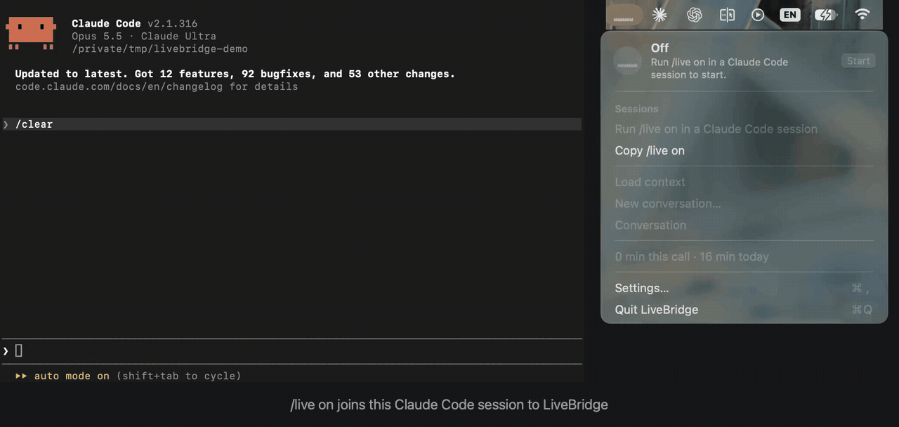

<p align="center"><a href="README.md">English</a> · <a href="README.zh-CN.md">简体中文</a> · <a href="README.hi.md">हिन्दी</a> · <a href="README.es.md">Español</a> · <a href="README.fr.md">Français</a> · <a href="README.ru.md">Русский</a> · <b>Українська</b></p>

<p align="center"></p>

<h1 align="center">LiveBridge</h1>

<p align="center"><strong>Розмовляйте голосом з відкритою сесією Claude Code.</strong></p>

<p align="center">
  <a href="https://github.com/getLiveBridge/LiveBridge/actions/workflows/ci.yml"></a>
  <a href="LICENSE"></a>
  
</p>

<p align="center">
  <a href="https://getlivebridge.com">getlivebridge.com</a> ·
  <a href="#швидкий-старт">Швидкий старт</a> ·
  <a href="#встановлення">Встановлення</a> ·
  <a href="#використання">Використання</a> ·
  <a href="#дбайливо-щодо-оплати">Оплата</a> ·
  <a href="#приватність">Приватність</a> ·
  <a href="#відомі-обмеження">Обмеження</a> ·
  <a href="#плани-та-де-потрібна-допомога">Потрібна допомога</a> ·
  <a href="#участь-у-розробці">Участь</a>
</p>

LiveBridge — це застосунок у рядку меню macOS, який тримає напоготові голосову лінію GPT-Live
через `codex app-server` на вашому вході в ChatGPT (без API-ключа). Голос працює як ресепшн:
розмовляє, перепитує, що ви маєте на увазі, і передає справжню роботу вашій сесії Claude Code
через невеликий мод Claude Code, `livebridge`. Claude виконує роботу власною моделлю, власними
інструментами та у власному режимі дозволів, а голос повідомляє вам результат.

*Основний текст — англійський ([README.md](README.md)); переклад може відставати.*

<p align="center"></p>

**Локально за задумом.** Жодної телеметрії та жодного власного сервера: LiveBridge — це міст на
вашому Mac між вашим власним codex і вашим власним Claude Code. Застосунок і мод спілкуються
через Unix-сокет, який може відкрити лише ваш користувач, а застосунок не слухає жодного
мережевого порту. Окрім того, що ці два інструменти й так надсилають (голосова лінія до OpenAI
через ваш codex, і лише поки вона відкрита, та робота Claude до Anthropic через вашу сесію
Claude Code), застосунок сам виходить у мережу лише заради [оновлень](#оновлення): автоматична
перевірка в GitHub, чи немає нового випуску (раз на день, а також під час запуску, доки
оголошений ним випуск не встановлено), яку можна вимкнути; та сама перевірка, коли ви натискаєте
**Check for update**; `gh auth status`, коли оголошено новий випуск; і завантаження, його
перевірка та оновлення мода, коли ви натискаєте **Install**. Що саме потрапляє до OpenAI,
перелічено в розділі [«Приватність»](#приватність), і там само названо запити застосунку до
GitHub; від чого це захищає, а від чого ні, сказано в [SECURITY.md](SECURITY.md).

> **Неофіційний проєкт.** Не пов'язаний з Anthropic чи OpenAI, не схвалений і не підтримуваний
> ними. Спирається на експериментальний realtime API codex, який може змінитися з будь-яким
> випуском codex.

## Швидкий старт

Потрібні macOS 14+ на Apple Silicon, Claude Code 2.1.289+ та
[codex](https://github.com/openai/codex) з виконаним входом (`codex login`) у план ChatGPT із
realtime-голосом; щоб зібрати застосунок самостійно, ще й Xcode зі Swift 6.0+. Подробиці — в
розділі [«Вимоги»](#вимоги).

```sh
# 1. The mod, from this repository's marketplace
claude plugin marketplace add getLiveBridge/LiveBridge
claude plugin install livebridge@livebridge

# 2. The app, built from source, installed in /Applications and opened
git clone https://github.com/getLiveBridge/LiveBridge.git
cd livebridge
scripts/build-app.sh --release
```

3. У сесії Claude Code, з якою хочете розмовляти, введіть `/live on`.
4. Натисніть **Start** у смузі над полем введення, дозвольте доступ до мікрофона й говоріть.

Не хочете збирати? У кожному [випуску](https://github.com/getLiveBridge/LiveBridge/releases/latest)
є застосунок у вигляді образу диска, який збирає й засвідчує GitHub Actions; як його перевірити
й відкрити, сказано в розділі [«З образу диска»](#з-образу-диска). Мод встановлюється однаково в
обох випадках.

Якщо `/live` не знайдено в сесії, що була відкрита вже раніше, відкрийте сесію заново
([чому](#відомі-обмеження)). Оновлення, дозволи, збереження дозволу на мікрофон між
перезбираннями та видалення описано в розділі [«Встановлення»](#встановлення).

## Вимоги

- macOS 14 або новіша на Apple Silicon.
- Claude Code 2.1.289 або новіший (моди).
- [Codex CLI](https://github.com/openai/codex) (`codex`, перевірено з 0.166.0), встановлений через
  Homebrew (`brew install --cask codex`) або npm (`npm install -g @openai/codex`), у `PATH`,
  який ваша оболонка задає у вікні Terminal, з виконаним входом через `codex login` у план
  ChatGPT, що включає realtime-голос. LiveBridge відмовляється працювати з codex, чий
  `codex features list` він не може прочитати, тож інша версія може не запуститися, доки
  LiveBridge не оновлять.
- Щоб зібрати застосунок: Xcode з інструментарієм Swift 6.0 або новішим. Перевірені версії
  наведено в [CONTRIBUTING.md](CONTRIBUTING.md#toolchain). Зібраний застосунок працює на macOS 14
  або новішій.

## Встановлення

Мод встановлюється з маркетплейсу цього репозиторію (команди зі [«Швидкого
старту»](#швидкий-старт)), який вказує на тег останнього випуску, тож ви встановлюєте мод саме
цього випуску. Застосунок в обох випадках опиняється в `/Applications`: з образу диска або
зібраний із вихідного коду. В обох випадках він підписаний ad hoc і не нотаризований.

### З образу диска

1. Завантажте
   [LiveBridge.dmg](https://github.com/getLiveBridge/LiveBridge/releases/latest/download/LiveBridge.dmg)
   з останнього випуску.
2. Перевірте його за допомогою [GitHub CLI](https://cli.github.com) у теці, куди збережено файл:

   ```sh
   gh attestation verify LiveBridge.dmg --repo getLiveBridge/LiveBridge \
     --signer-workflow getLiveBridge/LiveBridge/.github/workflows/release.yml \
     --source-ref refs/tags/vX.Y.Z --deny-self-hosted-runners
   ```

   де `vX.Y.Z` — тег випуску, як його названо на сторінці випуску. Перевірка проходить лише для
   образу, який [робочий процес випуску](.github/workflows/release.yml) цього репозиторію зібрав
   із цього тега на runner'і, що його надає GitHub, і який відтоді не змінився. Це єдиний доказ
   походження образу: підпис ad hoc нікого не називає. Того, що хтось переглянув код, це не
   доводить.
3. Відкрийте його й перетягніть LiveBridge до Applications.
4. Під час першого запуску macOS блокує застосунок, доки ви не дозволите його в System
   Settings > Privacy & Security > **Open Anyway**.

### З вихідного коду

`scripts/build-app.sh --release` збирає застосунок, встановлює його в `/Applications` (ваш
обліковий запис має мати право запису туди, як і обліковий запис адміністратора) і відкриває
його. Щоб перезібрати, запустіть команду ще раз. Збірка підписана ad hoc, тому після кожного
перезбирання macOS знову запитує доступ до мікрофона. Щоб зберегти дозвіл, один раз запустіть
`scripts/build-app.sh --make-signing-identity`: спершу скрипт запитає, потім створить
самопідписаний сертифікат для підпису коду у вашій в'язці ключів входу, і наступні
release-збірки підписуватимуться ним.

Маркетплейс закріплює мод за тегом останнього випуску, тож застосунок, зібраний з основної
гілки, працює з модом цього випуску. Щоб вони збігалися, зберіть тег випуску
(`git checkout vX.Y.Z`) або завантажте мод із робочої копії командою
`claude --plugin-dir plugin`.

Збірка з вихідного коду сама перевіряє оновлення, лише якщо ви ввімкнете це в Settings.
Встановлення оновлення замінює її образом випуску, який підписаний ad hoc, тож самопідписаний
сертифікат більше не діє; **Install** каже про це й спершу запитує.

### Оновлення

LiveBridge оновлює себе і свій мод, коли ви натискаєте **Install**, і ніколи сам по собі.
Оновлюється лише копія в `/Applications/LiveBridge.app`; будь-яка інша копія каже про це в
Settings.

- **Check for updates automatically** у Settings (типово ввімкнено, для збірки з вихідного коду
  вимкнено): раз на день застосунок запитує в GitHub, який випуск останній. Про новіший він
  повідомляє один раз, сповіщенням, чия кнопка **Install** його встановлює, а меню в рядку меню
  пропонує **Install LiveBridge X.Y.Z…**, доки його не встановлено, і заради цього пункту знову
  запитує GitHub під час кожного запуску. **Check for update** у Settings запитує одразу.
- Для **Install** потрібен [GitHub CLI](https://cli.github.com) з виконаним входом
  (`gh auth login`); без нього Install нічого не завантажує й дає посилання на сторінку випуску.
  Він завантажує образ випуску, перевіряє його тією самою командою `gh attestation verify`, що й
  вище, потім перевіряє застосунок усередині й нічого не встановлює, якщо не пройшла хоч одна
  перевірка. Він чекає, поки Claude ще зайнятий голосовим запитом, оновлює мод командами
  `claude plugin marketplace update livebridge` і `claude plugin update livebridge@livebridge`,
  зупиняє дзвінок, ставить новий застосунок на місце за один крок і відкриває його.
- Після цього Settings показує, з якої версії відбулося оновлення. Якщо мод оновити не вдалося,
  там будуть ці дві команди, щоб ви виконали їх самі. Сесії Claude Code, відкриті раніше,
  працюють зі старим модом, доки їх не перезапустити.
- Завантаження оновлення не ставить атрибут карантину, тож macOS не мала б блокувати перший
  запуск оновленого застосунку, як блокувала перше завантаження; це випливає з коду й поки що не
  перевірено на ділі. Замість цього блокування працюють перевірки вище
  ([SECURITY.md](SECURITY.md#what-an-update-installs)). Доступ до мікрофона macOS знову запитує
  під час першого **Start** після оновлення, бо кожен випуск підписаний ad hoc.

Щоб оновитися вручну, введіть `/live off` в усіх сесіях (мод знову відкриває застосунок із
`/Applications`, щойно той перестає відповідати), закрийте LiveBridge, встановіть образ новішого
випуску, як описано вище, і виконайте дві команди `claude plugin`.

### Дозволи

Перший Start запитує в macOS доступ до мікрофона. Якщо у доступі відмовлено, дзвінок зупиняється
з повідомленням, а пункт **Open Microphone Settings** у меню застосунку в рядку меню відкриває
Privacy & Security > Microphone, де потрібно дозволити LiveBridge. З підписом ad hoc macOS
запитує знову під час першого Start після кожного оновлення чи перезбирання (див. вище). macOS
також може запитати, чи може LiveBridge знаходити пристрої у вашій локальній мережі. Голосовій
лінії потрібен і цей другий дозвіл; без нього дзвінок зупиниться з повідомленням, у якому
сказано, де його дати.

### Видалення

З клона репозиторію `scripts/build-app.sh --uninstall` видаляє `/Applications/LiveBridge.app`,
хоч як його було встановлено, його елемент входу та всі файли, що він зберігає, і виводить дві
команди, які залишає вам: `tccutil reset Microphone com.getlivebridge.livebridge` та
`claude plugin uninstall livebridge@livebridge`.

Без клона вимкніть **Open at login** у Settings LiveBridge, закрийте LiveBridge і виконайте ті
самі кроки в Terminal:

```sh
rm -rf /Applications/LiveBridge.app ~/Library/Application\ Support/LiveBridge \
  ~/Library/{Caches,WebKit}/com.getlivebridge.livebridge \
  ~/Library/HTTPStorages/com.getlivebridge.livebridge{,.binarycookies} \
  ~/Library/Preferences/com.getlivebridge.livebridge.plist
tccutil reset Microphone com.getlivebridge.livebridge
claude plugin uninstall livebridge@livebridge
```

Жоден із цих способів не видаляє копію з назвою `/Applications/.LiveBridge-update-….app`, яку
може залишити оновлення, перерване посеред встановлення. Застосунок видаляє такі копії під час
наступного запуску; після видалення застосунку видаліть її вручну, якщо вона є.

## Використання

### Команди

У сесії Claude Code, з якою хочете розмовляти:

| Команда | Що робить |
|---|---|
| `/live on` | Приєднує сесію до LiveBridge під її заголовком і відкриває застосунок, якщо він не запущений. |
| `/live off` | Відключає сесію від LiveBridge. |
| `/live target` | Робить цю сесію тією, якій голос передає роботу. |
| `/live status` (або просто `/live`) | Один рядок: дзвінок, ціль, непрослухані результати, хвилини за сьогодні. |
| `/live context` | Надсилає голосу нове стисле резюме сесії, яке пише модель самої сесії. |

Команда називається `/live`, а не `/voice`, бо `/voice` — це власний голосовий режим Claude Code.
Чи завантажувати резюме сесії щоразу, коли відкривається лінія, визначає не команда: це одне
налаштування для всіх сесій у вікні [Settings](#налаштування) застосунку LiveBridge.

### Смуга й меню

Натисніть **Start** — у смузі над полем введення або в меню в рядку меню — і говоріть.

- **Start у смузі** робить її сесію ціллю, починає дзвінок; коли
  **Load context automatically when a line opens** увімкнено, відкрита ним лінія завантажує резюме сесії
  ([подробиці](docs/architecture/overview.md#components)). Поки дзвінок іде з іншою сесією,
  смуга показує **Talk here**. Якщо в приєднаній сесії смуги немає, `/live on` повертає її.
- **Меню в рядку меню** містить дзвінок, приєднані сесії (клацання робить сесію ціллю),
  **Load context**, **Conversation** цілі в тому вигляді, в якому його зберігає LiveBridge,
  хвилини, **Settings…** та **Quit LiveBridge**.
- **New conversation…** стирає розмову цілі та її завантажений контекст, а × біля сесії прибирає
  її й стирає її власну розмову; обидва пункти спершу запитують підтвердження. Голос починає
  наново від наступного відкриття лінії, а `/live on` у прибраній сесії приєднує її знову.

### Налаштування

**Settings…** відкриває вікно налаштувань LiveBridge:

- **Voice**: один із realtime-голосів, які пропонує ваш codex (codex перелічує їх, коли вікно
  відкривається), або **Codex default**. Звучить від наступного відкриття лінії.
- **Prompt** (типово порожній): ваші власні вказівки для голосу, наприклад «Speak with me in
  Spanish», до 2 000 символів. Їх додано після власних правил LiveBridge для голосу, які мають
  перевагу там, де вони розходяться, і діють від наступного відкриття лінії.
- **Load context automatically when a line opens** (типово ввімкнено): кожна
  лінія, яку відкриває застосунок (Start, лінія, відкрита знову після тиші, лінія після зміни цілі),
  запитує в цілі резюме й не чекає на нього; одне налаштування для всіх сесій, його зберігає
  застосунок.
- **Play a sound when a request is queued for Claude** (типово ввімкнено): короткий звук на
  кожен запит, який голос передає Claude ([чому](#відомі-обмеження)).
- **Notify when a result is waiting** (типово ввімкнено): разом із сигналом про результат, що
  чекає, поки лінія закрита, сповіщення macOS називає сесію («Alpha has a new result — speak to
  hear it»), але ніколи не сам результат. Клацання по ньому відкриває меню в рядку меню.
- **Open at login** (типово вимкнено).
- **Updates**: поточна версія, **Check for update**, **Check for updates automatically** і що
  зробило останнє оновлення ([«Оновлення»](#оновлення)).

### Що робить голос

- Сам відповідає на невимушену розмову та пояснення, а все, що потребує репозиторію чи сесії,
  передає далі: завдання, запитання про код, рішення, виправлення й зупинки.
- Перш ніж передати щось руйнівне або зовнішнє (видалити, запушити, опублікувати, надіслати,
  задеплоїти, сплатити), повторює запит і питає «так?». Це звичка, яку голосу велено
  дотримуватися, а не запобіжник; що є запобіжником, сказано в [SECURITY.md](SECURITY.md).
- Переказує результати одним-двома реченнями з назвою сесії. Блоки коду й таблиці залишаються в
  сесії, а розпізнані облікові дані приховуються.
- Коли Claude ставить запитання, голос ставить його вам і надсилає вашу відповідь назад у ту
  саму сесію. Робота, яку Claude завершує пізніше у фоні, повідомляється як оновлення.
- Коли Claude чекає на відповідь на запит дозволу, голос про це каже. На запит ви відповідаєте в
  Claude Code; LiveBridge ніколи не відповідає за вас.

## Дбайливо щодо оплати

Realtime-сесія голосу коштує, поки відкрита, тому LiveBridge відкриває її лише поки хтось
говорить або поки ще може прийти відповідь Claude на ваш щойно переданий запит:

- Поки дзвінок увімкнено й ніхто не говорить, мікрофон живить лише детектор голосу на вашому Mac.
  Нічого нікуди не надсилається.
- Коли ви починаєте говорити, лінія відкривається. Дві секунди до початку мовлення зберігаються
  й надсилаються першими, тож перші слова не губляться.
- Лінія закривається після 20 секунд тиші. Звук без слів (музика, телевізор) закриває її через
  90 секунд.
- Коли голос передає запит Claude (handoff), лінія залишається відкритою до 2 хвилин після цієї
  передачі й оплачується як будь-яка відкрита лінія, а голос озвучує відповідь Claude, щойно ніхто
  не говорить. Наступна передача починає ці 2 хвилини заново; обмін, що нічого не надсилає
  Claude, закривається після звичайних 20 секунд тиші.
- Результат, що надходить пізніше, коли лінія закрита, звучить сигналом і чекає: смуга та меню
  показують його як непрослуханий, а голос розповість про нього, коли ви заговорите наступного
  разу
  ([коли він вважається почутим](docs/architecture/overview.md#a-result-while-the-line-is-closed)).
- Кожна сесія Claude Code має власну розмову з голосом. Вона переноситься в наступну
  realtime-сесію, а також через Stop і Start, тож голос пам'ятає, що ви сказали хвилину тому.
  Нова ціль перемикає розмову: відкрита лінія закривається, а ваші наступні слова відкривають її
  з розмовою нової цілі.
- Меню показує хвилини, протягом яких лінія була відкрита, за вимірюванням застосунку; як ваш
  план тарифікує realtime-голос, не публікується.

## Приватність

LiveBridge не має телеметрії й не слухає жодного мережевого порту; мод спілкується із
застосунком через Unix-сокет у теці, яку може відкрити лише ваш користувач. До OpenAI через
realtime-сесію codex потрапляє таке:

- звук мікрофона, поки лінія відкрита: від двох секунд до початку вашого мовлення й до закриття
  лінії;
- інструкції голосу: власні правила LiveBridge, а потім ваш **Prompt** із Settings, якщо ви його
  написали;
- нещодавня розмова сесії-цілі (до 24 останніх реплік), щоб продовжити її в новій
  realtime-сесії;
- запити сесії-цілі, що ще не закриті, у вигляді їхніх однорядкових описів;
- кожен результат, запитання, оновлення та сповіщення про дозвіл — одним рядком не довшим за
  2 000 символів, без блоків коду й таблиць. Запитання, яке Claude ставить посеред ходу, і
  сповіщення про дозвіл, який запитав основний цикл Claude (не субагент), несуть й те, що Claude
  написав просто перед ними. Оновлення — це відповідь Claude в наступному ході, розпочатому
  сповіщенням фонового завдання, протягом 10 хвилин після голосового запиту й доки в сесії не
  почнеться будь-який інший хід;
- резюме контексту сесії-цілі — одним рядком не довшим за 1 500 символів. Воно зберігається під
  час завантаження й надсилається щоразу, коли лінія відкривається, поки ця сесія є ціллю, зокрема
  після Stop і Start та перезапуску застосунку. Підменю Conversation показує цей рядок точно в
  тому вигляді, в якому його надсилають;
- з кожним рядком вище — мітка його сесії: заголовок сесії Claude Code або, якщо його немає,
  назва теки сесії;
- WebRTC-пропозиція, яка перелічує локальні мережеві адреси Mac як кандидатів для з'єднання.

Результати, запитання, оновлення та резюме спершу проходять через фільтр відомих форм облікових
даних (приватні ключі, JWT, поширені API-токени, паролі в URL, поля на зразок `password=`). Це
список шаблонів, а не гарантія.

Тред codex, що несе голос, ефемерний і лише для читання, з вимкненими всіма функціями codex, крім
збереження вашого входу та способу використання вашого проксі, і з вимкненими всіма MCP-серверами;
він потрібен лише для розмови. Робота Claude потрапляє до Anthropic так, як і завжди у вашій сесії
Claude Code.

Заради оновлень застосунок звертається до GitHub. Якщо ввімкнено **Check for updates
automatically**, раз на день (і під час кожного запуску, доки оголошений ним випуск не
встановлено) він без облікових даних запитує в API GitHub, який випуск останній; GitHub бачить
IP-адресу вашого Mac. **Check for update** у Settings надсилає той самий запит, коли ви його
натискаєте. Коли автоматична перевірка знаходить новіший випуск, застосунок запускає
`gh auth status`, щоб сказати, чи можна перевірити образ. Лише коли ви натискаєте **Install**,
він завантажує образ і запускає `gh attestation verify` та `claude plugin`, які звертаються до
GitHub, а `gh` ще й до Sigstore по корінь довіри, під вашими власними входами. Кожен запит
перелічено в [SECURITY.md](SECURITY.md#what-leaves-the-mac).

На вашому Mac застосунок зберігає свої налаштування, лічильник хвилин, час останньої перевірки
оновлень і версії, про які він повідомив, що зробило останнє оновлення та, для кожної з 20
останніх використаних сесій, її нещодавню розмову й останній завантажений із неї рядок
контексту, у `~/Library/Application Support/LiveBridge`. Рядки сесії зникають, коли ви
натискаєте **New conversation**, поки вона є ціллю, або прибираєте її через ×. Сесія, що
відключилася, зберігає їх, доки їх не витіснять 20 пізніше використаних сесій; щоб стерти їх
раніше, знову введіть у ній `/live on` і натисніть **New conversation**. Видалення застосунку
стирає все.

У [SECURITY.md](SECURITY.md) — модель загроз; коротко: усе, що чує ваш мікрофон, може стати
запитом, який Claude виконає в режимі дозволів самої сесії.

## Відомі обмеження

- Голос іноді каже, що дивиться («On it», «Looking now»), але не передає запит, і до Claude
  нічого не доходить: приблизно один запит із п'яти під час [тестування](docs/bugs/BR-001.md),
  хоча правило голосу це забороняє. Застосунок грає короткий звук, коли ставить запит у чергу
  для Claude; якщо голос каже, що дивиться, а звуку немає, повторіть запит. За словами
  застосунок не може відрізнити таку обіцянку від відповіді: голос говорить вашою мовою.
- Результат, що надходить, поки лінія його чекає, передається голосу як текст для озвучення; у
  codex немає виклику, який змушує голос заговорити негайно, тож коли сказати, вирішує модель. Під
  час тестування голос озвучував його за кілька секунд. Якщо ні, результат залишається
  непрослуханим: голос скаже його після ваших наступних слів, або пролунає сигнал, коли лінія
  закриється.
- Коли ваші наступні слова знову відкривають лінію, голос іноді відповідає лише на них і не
  озвучує результат, що чекає. Результат не губиться: він далі чекає, звучить сигналом і
  надсилає сповіщення, коли лінія закривається, і знову передається голосу, коли лінія
  відкриється наступного разу.
- Сесії Claude Code, що була відкрита ще до завантаження мода, може знадобитися повторне
  відкриття, перш ніж у ній запрацює `/live`.
- У десктопному застосунку Claude `/live`, введена в сесії, процес Claude Code якої ще не
  запущений (нова сесія або щойно відкрита заново), може показати «/live isn't a command here.»
  Команда все одно виконується. Десктопний застосунок бере список команд такої сесії з перевірки,
  яку запускає з вимкненими хуками, тому код мода, що оголошує `/live`, там не виконується; коли
  сесія запущена, застосунок бере список у самої сесії. З боку мода це не виправити: статичний
  файл команди потрапив би до списку як `/livebridge:live`, а не `/live`, і з вимкненими хуками
  надіслав би свій текст моделі замість того, щоб запустити мод.
- Чи озвучила відповідь результат, що чекає, визначається за її словами, за списком поширених слів
  лише англійської та російської мов
  ([правило](docs/architecture/overview.md#a-result-while-the-line-is-closed)). Іншою мовою
  результат може зарахуватися почутим, коли голос лише згадав його.

## Як це працює

[docs/architecture/overview.md](docs/architecture/overview.md) описує компоненти, протокол між
модом і застосунком та потоки повідомлень;
[ADR 0001](docs/adr/0001-platform-findings.md) фіксує факти про платформу, на яких стоїть
дизайн.

## Плани та де потрібна допомога

Сьогодні LiveBridge — це один застосунок для Mac, один виконавець (Claude Code) і один постачальник
голосу (codex на вході в ChatGPT). Ці три частини стикуються вузькими швами, і кожен із напрямів
нижче відкритий для учасників. Завдання щодо них мають мітку
[help wanted](https://github.com/getLiveBridge/LiveBridge/issues?q=is%3Aissue+is%3Aopen+label%3A%22help+wanted%22);
з яких файлів почати, сказано в [CONTRIBUTING.md](CONTRIBUTING.md#where-to-start).

- **Windows і Linux.** Застосунок у рядку меню, його аудіосторінка та сервер сокета прив'язані до
  macOS; протокол між модом і застосунком та сам мод переносні. Перенесення починається із
  застосунку для нової платформи, який говорить тим самим протоколом.
- **Інші агенти як виконавці**, як-от Codex CLI, Hermes Agent або Gemini CLI: кожному потрібен
  власний адаптер, який говорить тим самим протоколом, що й мод Claude Code.
- **Інші постачальники голосу**, як-от OpenAI Realtime API з вашим власним API-ключем або Gemini
  Live API від Google: кожен був би ще однією реалізацією realtime-протоколу застосунку.

## Участь у розробці

Внески вітаються. Для всього, що більше за виправлення, спершу відкрийте задачу, щоб узгодити
форму до початку роботи. Добре почати із задач
[help wanted](https://github.com/getLiveBridge/LiveBridge/issues?q=is%3Aissue+is%3Aopen+label%3A%22help+wanted%22),
[відомих обмежень](#відомі-обмеження) та напрямів
[вище](#плани-та-де-потрібна-допомога).

- [CONTRIBUTING.md](CONTRIBUTING.md): структура репозиторію, інструментарій, перевірки
  (`scripts/check.sh`) та конвенції.
- [CODE_OF_CONDUCT.md](CODE_OF_CONDUCT.md): як ми поводимося одне з одним тут.
- [SECURITY.md](SECURITY.md): про вразливість повідомляйте приватно, а не у публічній задачі.
- [CHANGELOG.md](CHANGELOG.md): що змінилося в кожному випуску.

## Подяки

Протокол між модом і застосунком було надихнуто
[claude-code-voice-mod](https://github.com/ldk00315-jpg/claude-code-voice-mod). Жодного коду чи
тексту звідти не копіювали.

## Ліцензія

[MIT](LICENSE).
