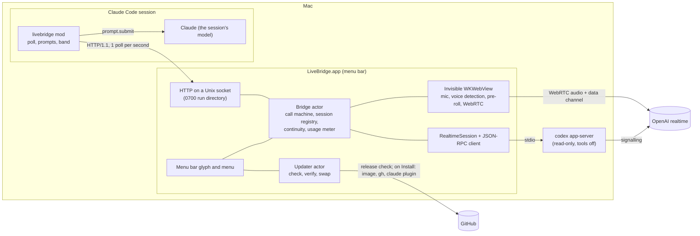
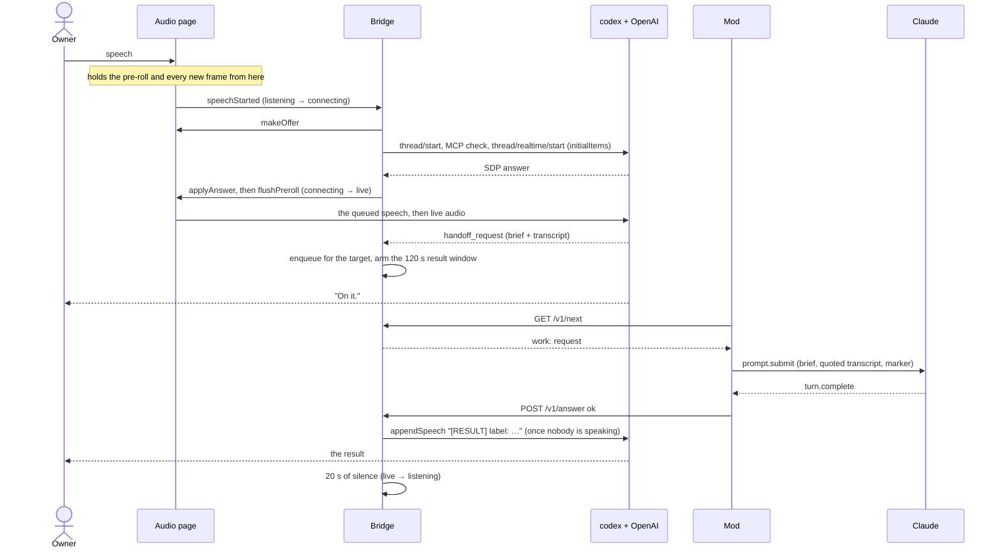
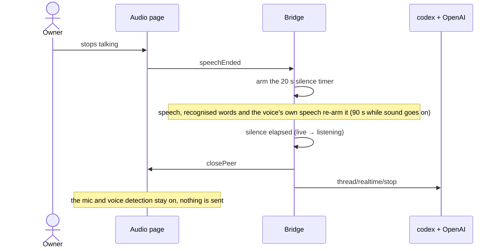
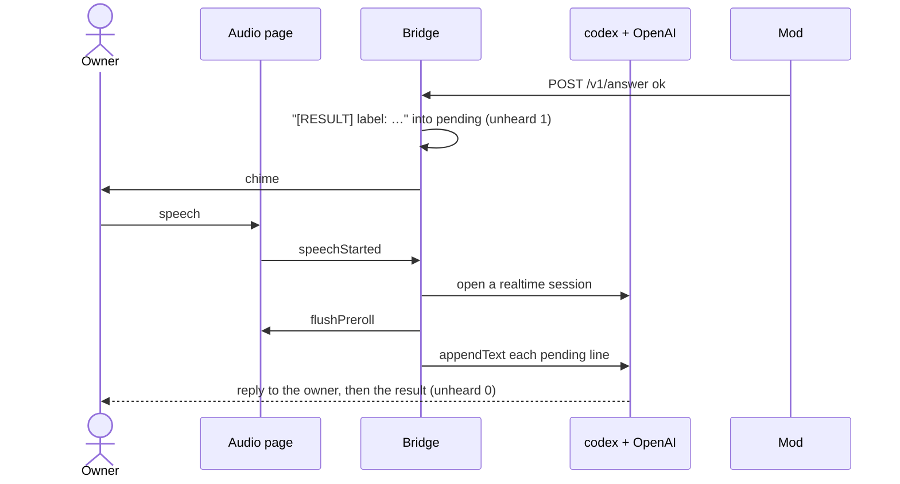
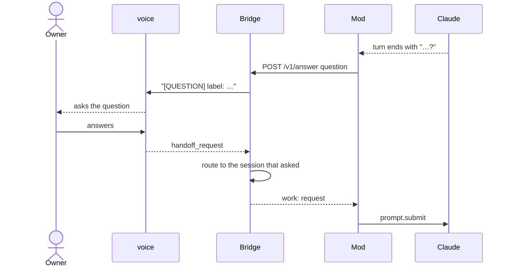
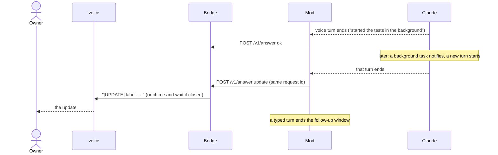
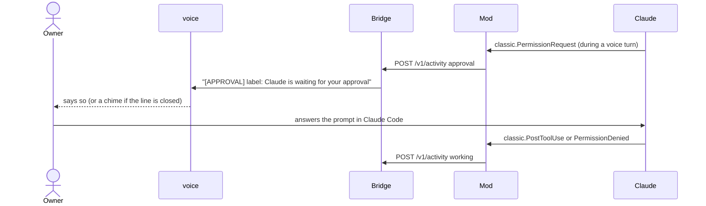
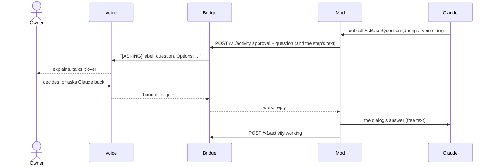

# Architecture overview

LiveBridge lets the owner of a Mac talk to an open Claude Code session. A voice model (GPT-Live,
reached through `codex app-server`) talks with the owner; the session's own Claude model does the
work. This document names the parts, what each promises, and how the messages flow. The
platform facts behind these choices are in [ADR 0001](../adr/0001-platform-findings.md).

## Components

**`BridgeCore`** (Swift library, no UI) holds every rule, so it is tested without codex, a
microphone or Claude:

- `CallMachine`: the call's phase — `off`, `listening` (microphone and local voice detection
  only), `connecting`, `live` (a realtime session is open) — and the effects of each event. It
  is pure; `Bridge` runs the effects in order.
- `SessionRegistry`: the joined sessions, the voice target, each session's queued and in-flight
  request, and their liveness. A session that has not polled for 5 s is dropped, and a request in
  flight for 10 minutes fails; either is reported to the voice as `[FAILED]`, unless the dropped
  session was the last one, which stops the call ([failure behaviour](#failure-behaviour)).
- `Continuity`: one conversation per Claude Code session, by session id: its last 24 lines
  (the owner's, the voice's, the lines the session sent the voice and the brief of each request
  its queue took) and the context loaded from it. Each new realtime session is seeded with the
  target's conversation, less those briefs (an open request goes in as its task), and only the
  target's open tasks (`initialItems`), so the voice does not notice it was replaced and never
  mixes two sessions' conversations; a new target closes an open line. A result from another session is spoken in the open line and kept in its
  own session's conversation. New conversation forgets the target's, removing a session forgets
  its own, and only the 20 conversations used last are kept.
- `RealtimeSession`: one ephemeral, read-only codex thread per realtime session; it refuses to go
  on unless codex reports every MCP server disabled, interrupts every codex turn and declines
  every request codex sends.
- `AnswerShaper` and `Redaction`: each delivery to the voice becomes one line, `[TAG] label:
  text`, of at most 2,000 characters, with the label cut to 120 characters, without code blocks
  or tables, and with credentials redacted.
- `UnixHTTPServer` and `Wire`: the mod's routes (below).
- `Update/`: the in-app update ([below](#update)). `AppVersion` and `Release` parse a version
  and GitHub's `releases/latest` reply strictly; `UpdatePolicy` says when a check is due and
  which copy may update; `DownloadRules` limits redirects to GitHub's hosts and the size of a
  download; `UpdateBundleCheck` reads the image's app and the programs' output; `UpdateRecord`
  and `UpdateState` are what a run leaves for the next launch; `UpdateProblem` gives each failure
  its sentence. `Updater` is the actor that runs a check or an install through
  `UpdateEnvironment`, a protocol over the network, the programs, the swap and the relaunch, so
  the tests use a fake.

**`LiveBridge`** (the app target) wires `BridgeCore` to the menu bar, to `SMAppService` for Open at
login, and to `AudioHost`: one `WKWebView` in an invisible window (one point, fully transparent,
click-through, ordered in on every Space, because WebKit holds back the microphone of a page it
does not consider visible), serving the bundled audio page under its own URL scheme. Before the
page opens the microphone, the app asks macOS for it itself (WebKit's request never shows the
prompt for this app). The page owns the microphone, a voice detector (−45 dBFS
for 250 ms starts speech), a 2-second pre-roll and the WebRTC peer; after a connect it plays the
queued audio into the peer, dropping silence until it has caught up. For updates,
`SystemUpdateEnvironment` is the real `UpdateEnvironment` (an ephemeral `URLSession`, `gh`,
`diskutil`, `codesign`, `ditto`, `xattr`, `claude`, `renamex_np` and the relaunch), Settings'
`UpdateSection` shows the version and the run, and the menu and `Notifier` offer an announced
release's Install.

**The mod** (`plugin/`) declares `/live`, joins the bridge under the session's title (the
desktop's own, read from Claude Code's session registry, or the folder's name while it has none)
and joins again when that title changes, polls it once a second, submits each voice request to
the session as a prompt, and posts the turn's answer back. It tells voice turns from typed and
background ones by the request marker on the prompt's last line and by the `prompt.submit`
origin. A voice turn is one that has started: while a voice request waits for the running turn
to end, that turn's questions, and the notice of its permission prompts, stay in Claude Code. It
draws a band above the prompt with the call's phase, the target, the unheard count and the
buttons Start/Stop and Talk here, with the problem sentence on a row of its own. A surface
that has drawn no band for 3 s while the session is joined is asked for it again, and `/live on`
in a joined session asks every surface for it. Start
makes the session the target, starts the call and sends the session's summary (none for a
session with no prompt yet; the last one again, with no model call, while no turn has completed
since it was written), with a short note in the band while it goes. Talk here shows only while
the call talks to another session, and moves it here. When the socket does not answer, it opens
`/Applications/LiveBridge.app`, where both install routes put it, with `open -g`, and falls back
to `open -g -b <bundle id>`.

## The wire

HTTP/1.1 over `~/Library/Application Support/LiveBridge/run/bridge.sock`, JSON
bodies, no other access control than the run directory's mode. The app finds that folder through
Foundation, which honours `CFFIXED_USER_HOME`; the mod builds the path from `CFFIXED_USER_HOME`
when it is set, else from `HOME`. `Wire.swift` and
`plugin/hooks/wire.ts` mirror each other, and `wire/fixtures/` holds one example of every message
that both test suites parse.

| Route | Body or reply |
|---|---|
| `POST /v1/join` | `sessionId`, `title`, `replaces` after `/clear`; an upsert that also refreshes liveness |
| `POST /v1/leave` | `sessionId`; a request it leaves open fails |
| `GET /v1/next?sessionId=` | the status and at most one piece of work: a request, a reply to Claude's question or a context ask |
| `POST /v1/answer` | `id`, `status` (`ok`, `failed`, `question`, `update`), `text`, `reason` |
| `POST /v1/activity` | `idle`, `working` or `approval`; `question` with `approval` is what Claude asks the owner in a voice turn |
| `POST /v1/context` | the session's summary; the app redacts it and cuts the whole `[CONTEXT] label: …` line to 1,500 characters |
| `POST /v1/target`, `POST /v1/call` | make this session the target; Start or Stop |

Every reply carries the status: the phase, the sessions with their labels (`Title · ab12` when
two titles are the same) and which one is the target, the minutes today, the problem sentence
and the count of unheard results. What only the app's menu shows (the minutes this call, the
target's context line and its conversation) is not on the wire.

A session the owner removed with the menu's × is gone as if it had left, and until the owner
joins it again (`/live on`, the only join that sends `"owner": true`) every call from it,
its own automatic joins included, answers `410` with `"code": "removed"`. The mod then turns itself off
for that session and logs "Removed from LiveBridge. /live on joins again." instead of joining
again, as it does after a `404` (the app restarted).

## Flows

### Handoff

The owner speaks; the line opens with the pre-roll, the voice hands the request off, and the line
stays open for its result up to `CallMachine.resultWindowSeconds` (120 s) after the latest
handoff, however silent it is (sound without words still closes it after 90 s). A result from a session handed a request in that window is given
to the voice to say now (`thread/realtime/appendSpeech`, speakable text) once neither the owner
(local voice detection) nor the voice is speaking; when either was, the bridge waits until both
are silent and then a grace of 0.8 s. The window then ends and the 20 s silence rule closes the
line. A window that passes with no result closes the line once it is silent; that result chimes
later as below. A line with no handoff waiting keeps the plain silence rule, so an exchange that
sends nothing to Claude costs no more than before. codex has no request that makes the v3 voice
respond, so whether it says the speakable text at once is the model's choice
([ADR 0001](../adr/0001-platform-findings.md) (b)).

### Silent hang-up

The realtime session is billed while open, so silence closes it. Voice detection keeps running
on the Mac, and the next speech opens a new session seeded with the target's conversation so
far. A new target closes an open line the same way, so the next speech opens it with the new
target's conversation.

### A result while the line is closed

A result that arrives while the line is closed (after the window, or after a hang-up) does not
reopen it. It chimes and waits; the voice gets it when the owner next speaks and says it in a
reply. A result for a session the open line is not waiting on is added as context and said in
the voice's next reply.

A result stays unheard until the voice finishes a reply that it began after the result and
that says it. A word counts when it has four letters or more and is not in a short list of
common words (English and Russian only). The reply must say two of the result's words, or the
session's label together with one of them. The label alone counts only for a result that has no
such word, which could not be heard otherwise. The handoff's own acknowledgement never counts,
nor does a reply the owner cut off before it got there. If the line closes first, the result
chimes and waits again: it may be said twice, but it is never lost.

This is the one description of the rule; the README links here.

A newer request to the same session withdraws its older unheard result, a timed-out one
included, so the voice never reads an answer that has been superseded. An `[APPROVAL]` notice is
withdrawn once the approval is settled.

### Question loop

An answer that ends with a question goes back to the owner, and the owner's reply is handed to
the session that asked, even if another session is the target.

### Later update

Work Claude starts from a voice request can finish in a later turn started by a background
task's notification (a returning background agent included). For 10 minutes after the voice
request, and until any other turn starts, each such turn's answer is posted as an update to that
request. A turn of any other origin, one the mod does not know or does not see included, closes
the window and is never sent to the voice.

### Approval notice

The bridge never answers a permission prompt. When a voice turn hits one, the voice says that
Claude is waiting; the owner answers in Claude Code.

### Claude's question mid-turn

When Claude asks the owner a question during a voice turn (the AskUserQuestion dialog), the
dialog opens as usual and the question, with its options, goes to the voice as an `[ASKING]`
line. What Claude wrote in the same model step follows the options in that line: the engine's
turn end carries only the turn's last text, so it would reach the voice no other way, and after
the options the app's cut of a long line takes it before any choice. The voice explains it and talks it over from what it knows, without handoffs; the owner's
next handoff to that session is the reply. It goes out at once as `reply` work, beside the
request in flight, and the mod returns it as the dialog's free-text answer, which closes the
dialog. An answer at the keyboard that comes first withdraws the line, and a reply the session
has not polled by then goes as a request of its own.

### Update

Only the copy at `/Applications/LiveBridge.app` (the bundle, symlinks resolved, is that path, and
the path is not a symlink) makes an `Updater`; any other copy says so in Settings and never
checks. A check asks `https://api.github.com/repos/getLiveBridge/LiveBridge/releases/latest`
and reports `available` for a plain `vX.Y.Z` tag newer than the running version. With
**Check for updates automatically** on (`Settings.checkUpdatesAutomatically`, nil meaning on for a
release build and off for one with `LBSourceBuild`), the app asks at launch, every
`UpdatePolicy.tick` (15 minutes) and on wake whether a check is due: 24 hours since the last
one GitHub answered, or a clock that moved back; a check that did not reach GitHub (common right
after a wake) is tried again at the next tick. A newer release is announced once per version, by a
notification with an Install action and a menu item; `updates/state.json` keeps the last check's
time and the versions announced.

Install runs only from the owner's click, one run at a time (the actor's flag, and the lock file
`updates/lock` against a second instance). Programs start by absolute path except `gh` and
`claude`, which are found on the owner's shell `PATH` as `codex` is, and each has a timeout
(30 s, 120 s for `claude`):

1. `gh` is found and `gh auth status` passes, or nothing is downloaded.
2. The image is downloaded from the release URL built from the version into
   `updates/<X.Y.Z>/`, following redirects only to GitHub's asset hosts, and at most 100 MB.
3. `gh attestation verify`, pinned to `release.yml`, the tag and GitHub-hosted runners, passes,
   and its attested digest equals the image's SHA-256.
4. The image is attached read-only with `diskutil image attach`, at a mount folder of the run's
   own; its `LiveBridge.app` has the bundle id, the version and a minimum macOS this Mac meets,
   and passes `codesign --verify --deep --strict`; its CDHash is kept. It is copied with `ditto`
   to `/Applications/.LiveBridge-update-<uuid>.app`, an eject is attempted on every path, and
   the staged copy must have the same CDHash before a quarantine attribute on it is removed.
5. While any joined session has a request queued or in flight (`Bridge.hasOpenRequests`), the
   run waits (`waiting`).
6. `claude plugin marketplace update livebridge` and `claude plugin update livebridge@livebridge`
   run in the data folder; `claude plugin list --json` must then report the release's version,
   or the record carries the two commands for the owner.
7. The wait of step 5 again, then the call stops and the wait runs once more (for a request
   opened just before the stop); the staged copy is checked again (a directory, not a symlink,
   the same CDHash, `codesign` passes) and swapped with the installed app by
   `renamex_np(…, RENAME_SWAP)`. From here any launch of the path, the mod's included, starts the
   new version; the running process keeps its binary.
8. `updates/record.json` is written, a `/bin/sh` loop (`RelaunchScript`) waits for this process
   to exit and then `open`s the app, a second apart, until a process of the owner's runs the
   installed app's own executable (a `LiveBridge` built elsewhere does not count) or ten
   attempts have passed, and the app quits.

A failure before the swap, step 7's own re-check included, leaves the installed app as it was
and removes the staged copy; the image folder is removed on every path. When it comes after step
6 updated the mod, the mod stays at the new version, and the failure's sentence says so
(`UpdateProblem.modAlreadyUpdated`). Why the install waits for
the owner's click, and what that costs, is
[ADR 0002](../adr/0002-the-app-updates-itself-on-the-owners-click.md).

**At launch**, the installed copy removes every `/Applications/.LiveBridge-update-*.app` (the old
bundle, or a copy a crashed run left) and, unless `updates` is a symlink, every version folder and
the lock in it. It reads `updates/record.json`: Settings shows it until the next update, and
`LiveBridge updated to X.Y.Z` is posted once (the record is marked first). With automatic checks
on, a release announced before and newer than the running app is looked up again so the menu
keeps offering it. The bridge's socket is bound in the meantime, retrying every 200 ms for up to
10 s while the old instance still answers on it; an instance that stops removes the socket file
only if it is still the one it bound.

## Failure behaviour

- **No session joined:** Start is disabled in the menu. From the band or the socket, Start
  does nothing but report "No Claude Code session has joined: run /live on in a session, then
  start."; the sentence goes when a session joins. The last session leaving (`/live off`, the
  session closing, the menu's ×, or no poll for 5 s) stops a call that is on, a Start still
  launching codex included, as Stop does, and reports the same sentence.
- **Codex missing or signed out:** Start reports why in one sentence, in the menu and the
  band, and the call stays off. So does a `codex features list` that fails, cannot be read, or
  gives no answer within 10 s.
- **A plan without realtime voice, or any realtime error:** the first connect reports codex's
  own words in one sentence, with a hint when they name sign-in or the plan, and the call goes
  back to `listening`.
- **Codex installed with npm, or found only through a shell's start-up files:** the app reads
  `PATH` from the user's own shell (at most 3 s) and starts codex with it; a codex whose runtime
  is still missing gets its own sentence.
- **The app not running:** the mod opens it; while the socket does not answer for 10 s the band
  says "bridge offline". After the app restarts, the mod joins again on its next poll; the call
  starts off.
- **Codex exits or stops answering under the app:** the next speech reports it once, and the
  speech after that starts a fresh codex. A request codex leaves unanswered past its timeout
  ends that codex as an exit does.
- **The microphone is denied, missing, busy or lost:** the call goes to `off` with the reason.
  Denied says where to allow it, and the menu offers to open that setting. Busy means it
  could not be opened, perhaps because another app holds it; a request still pending after
  10 s fails with its own sentence instead of listening to nothing. When the
  default input changes mid-call, the page takes the new one and keeps the peer.
- **Local Network access blocked:** with no ICE candidate within 2 s, the call goes to `off` with a
  sentence naming the setting.
