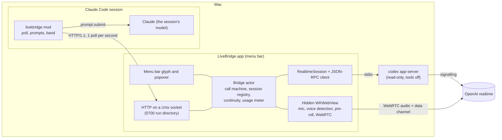
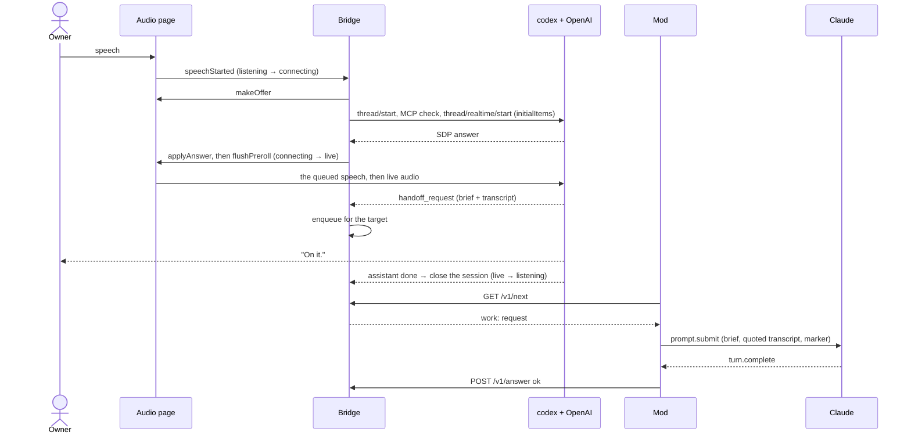
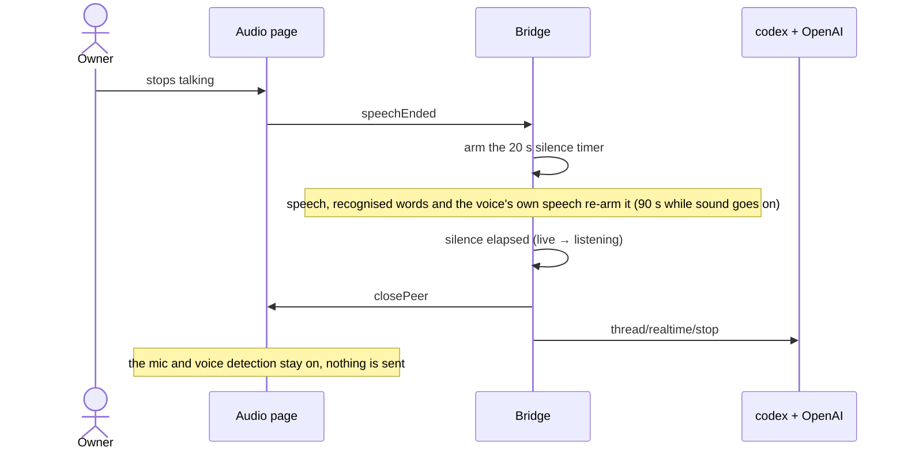
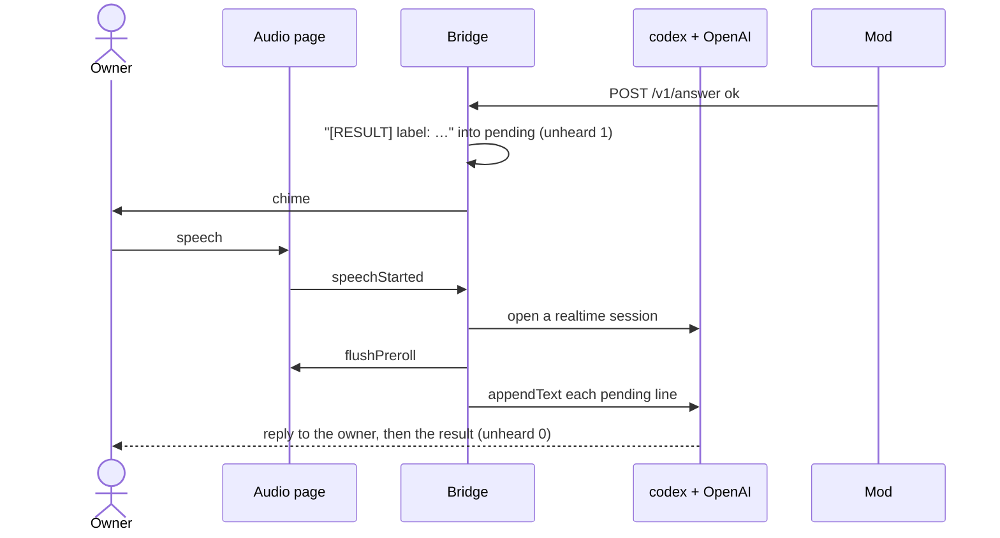
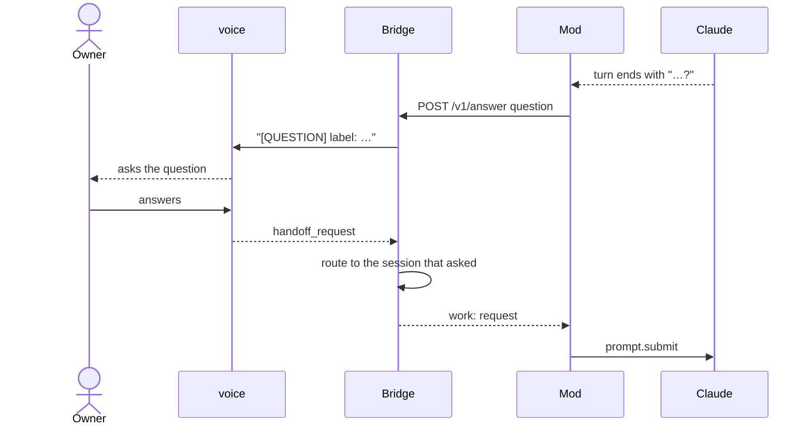
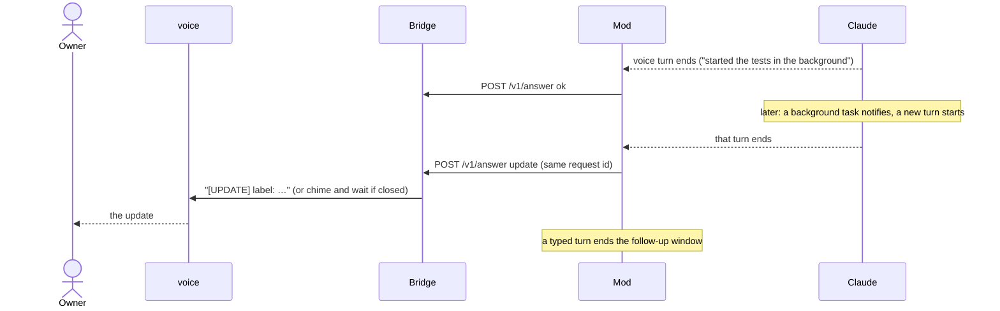
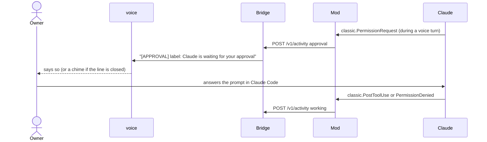

# Architecture overview

LiveBridge lets the owner of a Mac talk to an open Claude Code session. A voice model (GPT-Live,
reached through `codex app-server`) talks with the owner; the session's own Claude model does the
work. This document names the parts, what each promises, and how the messages flow. The
platform facts behind these choices are in [ADR 0001](../adr/0001-platform-findings.md).

## Components

**`BridgeCore`** (Swift library, no UI) holds every rule, so it is tested without codex, a
microphone or Claude:

- `CallMachine`: the call's phase — `off`, `listening` (microphone and local voice detection
  only), `connecting`, `live` (a realtime session is open) — and the effects of each event. It
  is pure; `Bridge` runs the effects in order.
- `SessionRegistry`: the joined sessions, the voice target, each session's queued and in-flight
  request, and their liveness. A session that has not polled for 5 s is dropped, and a request in
  flight for 10 minutes fails; either is reported to the voice as `[FAILED]`.
- `Continuity`: the last 24 lines of the conversation and the loaded context, seeded into each
  new realtime session (`initialItems`) so the voice does not notice it was replaced.
- `RealtimeSession`: one ephemeral, read-only codex thread per realtime session; it refuses to go
  on unless codex reports every MCP server disabled, interrupts every codex turn and declines
  every request codex sends.
- `AnswerShaper` and `Redaction`: each delivery to the voice becomes one line, `[TAG] label:
  text`, of at most 2,000 characters, without code blocks or tables, with credentials redacted.
- `UnixHTTPServer` and `Wire`: the mod's routes (below).

**`LiveBridge`** (the app target) wires `BridgeCore` to the menu bar, to `SMAppService` for Open at
login, and to `AudioHost`: one `WKWebView` in a window that is never shown, serving the bundled
audio page under its own URL scheme. The page owns the microphone, a voice detector (−45 dBFS
for 250 ms starts speech), a 2-second pre-roll and the WebRTC peer; after a connect it plays the
queued audio into the peer, dropping silence until it has caught up.

**The mod** (`plugin/`) joins the bridge under the session's title, polls it once a second,
submits each voice request to the session as a prompt, and posts the turn's answer back. It
tells voice turns from typed and background ones by the request marker on the prompt's last line
and by the `prompt.submit` origin. It draws a band above the prompt with the call's phase, the
target and Start/Stop, and opens the app with `open -g -b` when the socket does not answer.

## The wire

HTTP/1.1 over `~/Library/Application Support/claude-gpt-live-bridge/run/bridge.sock`, JSON
bodies, no other access control than the run directory's mode. `Wire.swift` and
`plugin/hooks/wire.ts` mirror each other, and `wire/fixtures/` holds one example of every message
that both test suites parse.

| Route | Body or reply |
|---|---|
| `POST /v1/join` | `sessionId`, `title`, `autoContext`; an upsert that also refreshes liveness |
| `POST /v1/leave` | `sessionId`; a request it leaves open fails |
| `GET /v1/next?sessionId=` | the status and at most one piece of work: a request or a context ask |
| `POST /v1/answer` | `id`, `status` (`ok`, `failed`, `question`, `update`), `text`, `reason` |
| `POST /v1/activity` | `idle`, `working` or `approval` |
| `POST /v1/context` | the session's summary, at most 1,500 characters after redaction |
| `POST /v1/target`, `POST /v1/call` | make this session the target; Start or Stop |

Every reply carries the status: phase, target, sessions with labels (`Title · ab12` when two
titles are the same), minutes, the problem sentence, the context last sent, the last three
lines and the count of unheard results.

## Flows

### Handoff

The owner speaks; the line opens with the pre-roll, the voice hands the request off, Claude
works on it, and the line closes as soon as the voice has acknowledged.

### Silent hang-up

The realtime session is billed while open, so silence closes it. Voice detection keeps running
on the Mac, and the next speech opens a new session seeded with the conversation so far.

### A result while the line is closed

A result that arrives while the line is closed does not reopen it. It chimes and waits; the
voice gets it when the owner next speaks and says it in its next reply.

A result stays unheard until the voice has finished a reply after it, the handoff's own
acknowledgement aside. If the line closes first, the result chimes and waits again: it may be
said twice, but it is never lost.

A newer request to the same session withdraws its older unheard result, so the voice never reads
an answer that has been superseded.

### Question loop

An answer that ends with a question goes back to the owner, and the owner's reply is handed to
the session that asked, even if another session is the target.

### Later update

Work Claude starts from a voice request can finish in a later turn started by a background
task's notification (a returning background agent included). For 10 minutes after the voice
request, and until any other turn starts, each such turn's answer is posted as an update to that
request. A turn of any other origin, one the mod does not know or does not see included, closes
the window and is never sent to the voice.

### Approval notice

The bridge never answers a permission prompt. When a voice turn hits one, the voice says that
Claude is waiting; the owner answers in Claude Code.

## Failure behaviour

- **Codex missing or signed out:** Start reports why in one sentence, in the popover and the
  band, and the call stays off.
- **A plan without realtime voice, or any realtime error:** the first connect reports codex's
  own words in one sentence, with a hint when they name sign-in or the plan, and the call goes
  back to `listening`.
- **Codex installed with npm, or found only through a shell's start-up files:** the app reads
  `PATH` from the user's own shell (at most 3 s) and starts codex with it; a codex whose runtime
  is still missing gets its own sentence.
- **The app not running:** the mod opens it; while the socket does not answer for 10 s the band
  says "bridge offline". After the app restarts, the mod joins again on its next poll; the call
  starts off.
- **Codex exits under the app:** the next speech reports it once, and the speech after that
  starts a fresh codex.
- **The microphone is denied, missing or lost:** the call goes to `off` with the reason. When the
  default input changes mid-call, the page takes the new one and keeps the peer.
- **Local Network access blocked:** with no ICE candidate within 2 s, the call goes to `off` with a
  sentence naming the setting.
