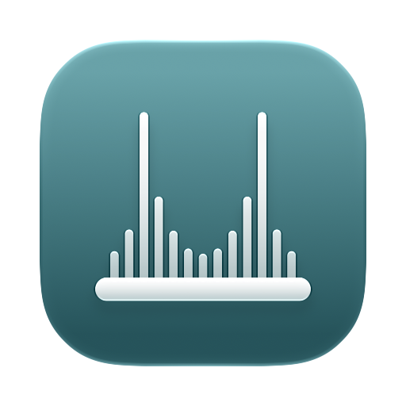
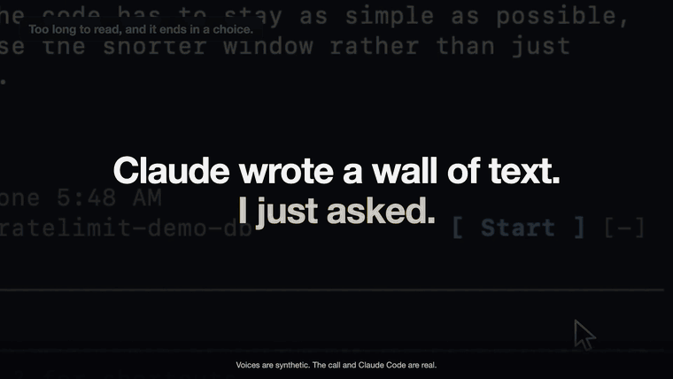

<p align="center"><a href="../../README.md">English</a> · <a href="README.zh-CN.md">简体中文</a> · <a href="README.hi.md">हिन्दी</a> · <a href="README.es.md">Español</a> · <b>Français</b> · <a href="README.ru.md">Русский</a> · <a href="README.uk.md">Українська</a></p>

<p align="center"></p>

<h1 align="center">LiveBridge</h1>

<p align="center"><strong>Parlez à voix haute à une session Claude Code ouverte.</strong></p>

<p align="center">
  <a href="https://github.com/getLiveBridge/LiveBridge/actions/workflows/ci.yml"></a>
  <a href="https://scorecard.dev/viewer/?uri=github.com/getLiveBridge/LiveBridge"></a>
  <a href="https://www.bestpractices.dev/projects/16502"></a>
  <a href="../../LICENSE"></a>
  
</p>

<p align="center">
  <a href="https://getlivebridge.com">getlivebridge.com</a> ·
  <a href="#démarrage-rapide">Démarrage rapide</a> ·
  <a href="#installation">Installation</a> ·
  <a href="#utilisation">Utilisation</a> ·
  <a href="#facturation-maîtrisée-par-conception">Facturation</a> ·
  <a href="#confidentialité">Confidentialité</a> ·
  <a href="#limitations-connues">Limitations</a> ·
  <a href="#feuille-de-route-et-aide-recherchée">Aide recherchée</a> ·
  <a href="#contribuer">Contribuer</a>
</p>

LiveBridge est une application de barre des menus macOS qui garde une ligne vocale GPT-Live prête à
l'emploi via `codex app-server`, avec votre connexion ChatGPT (sans clé d'API). La voix fait office
d'accueil : elle discute, demande ce que vous voulez dire, et confie le vrai travail à votre session
Claude Code par l'intermédiaire d'un petit mod Claude Code, `livebridge`. Claude fait le travail
avec son propre modèle, ses propres outils et son propre mode de permissions, et la voix vous
annonce le résultat. Inutile de garder la ligne ouverte pendant que Claude travaille : sa réponse
rouvre la ligne fermée et passe à la voix pour qu'elle la dise. La voix suit aussi ce que vous tapez
dans la session et ce que Claude répond, vous pouvez donc passer de la parole au clavier.

*Le texte anglais fait foi ([README.md](../../README.md)) ; cette traduction peut avoir du retard.*

**Une conversation, pas une dictée.** GPT-Live écoute pendant qu'il parle : coupez-le et il s'arrête pour vous écouter ; pensez à voix haute et il peut glisser un petit « mm-hmm ». **Vous cessez de payer le silence :** OpenAI facture la voix à la minute, donc après un temps de silence que vous réglez dans [Settings](#réglages) la ligne se ferme et se rouvre dès que vous parlez, la conversation reprenant là où vous l'aviez laissée ([Facturation](#facturation-maîtrisée-par-conception)).

<p align="center"></p>

**Local par conception.** Pas de télémétrie et pas de serveur propre : LiveBridge est un pont sur
votre Mac entre votre propre codex et votre propre Claude Code. L'application et le mod
communiquent uniquement par un socket Unix que seul votre utilisateur peut ouvrir, et
l'application n'écoute sur aucun port réseau. En dehors de ce que ces deux outils envoient déjà
(la ligne vocale vers OpenAI via votre codex, uniquement tant qu'elle est ouverte, avec ce que vous tapez dans une session rejointe, et le travail
de Claude vers Anthropic via votre session Claude Code), le seul trafic propre à l'application
est un codex éphémère qui, à l'ouverture du menu, demande à OpenAI vos chiffres d'utilisation de
Codex, même quand l'appel est coupé, et celui des [mises à jour](#mises-à-jour) : une demande automatique à GitHub pour savoir s'il existe
une nouvelle version (quotidienne, et à chaque lancement tant qu'une version qu'elle a annoncée
n'est pas installée), que vous pouvez désactiver ; la même demande quand vous cliquez sur **Check
for update** ; `gh auth status` quand une nouvelle version est annoncée ; et, quand vous cliquez
sur **Install**, le téléchargement, sa vérification et la mise à jour du mod.
[Confidentialité](#confidentialité) liste précisément ce qui parvient à OpenAI et nomme les
requêtes de l'application vers GitHub ; [SECURITY.md](../../SECURITY.md) explique ce que cela protège
et ce que cela ne protège pas.

> **Non officiel.** Sans lien avec Anthropic ou OpenAI, qui ne l'approuvent ni ne le prennent en
> charge. Il s'appuie sur l'API temps réel expérimentale de codex, qui peut changer à chaque
> version de codex.

## Démarrage rapide

Il vous faut macOS 14+ sur Apple Silicon, Claude Code 2.1.301+, et
[codex](https://github.com/openai/codex) connecté (`codex login`) à une offre ChatGPT dont le Codex
inclut la voix ; pour compiler l'application vous-même, il faut aussi Xcode avec Swift 6.0+.
Le détail se trouve sous [Prérequis](#prérequis).

```sh
# 1. The mod, from this repository's marketplace
claude plugin marketplace add getLiveBridge/LiveBridge
claude plugin install livebridge@livebridge

# 2. The app, built from source, installed in /Applications and opened
git clone https://github.com/getLiveBridge/LiveBridge.git
cd livebridge
scripts/build-app.sh --release
```

3. Dans la session Claude Code à laquelle vous voulez parler, tapez `/live`.
4. Appuyez sur **Start** dans la bande au-dessus du prompt, autorisez le microphone, et parlez.

Vous préférez ne pas compiler ? Chaque [version](https://github.com/getLiveBridge/LiveBridge/releases/latest)
fournit l'application sous forme d'image disque, compilée et attestée par GitHub Actions ;
[Depuis l'image disque](#depuis-limage-disque) explique comment la vérifier et l'ouvrir. Le mod
s'installe de la même manière dans les deux cas.

Si `/live` est introuvable dans une session déjà ouverte, rouvrez la session
([pourquoi](#limitations-connues)). La mise à jour, les autorisations, la conservation de
l'autorisation du microphone d'une recompilation à l'autre et la désinstallation sont décrites
sous [Installation](#installation).

## Prérequis

- macOS 14 ou ultérieur sur Apple Silicon.
- Claude Code 2.1.301 ou ultérieur.
- [Codex CLI](https://github.com/openai/codex) (`codex`, testé avec 0.166.0), installé avec
  Homebrew (`brew install --cask codex`) ou npm (`npm install -g @openai/codex`), présent dans le
  `PATH` que votre shell définit dans une fenêtre Terminal, et connecté avec `codex login` à une
  offre ChatGPT dont le Codex inclut la voix (Plus, Pro, Business, Enterprise ou Education, selon
  les [tarifs de Codex d'OpenAI](https://learn.chatgpt.com/docs/pricing)). LiveBridge refuse un codex dont il ne peut pas
  lire le `codex features list`, donc une autre version peut ne pas démarrer tant que LiveBridge
  n'a pas été mis à jour.
- Pour compiler l'application : Xcode avec une chaîne d'outils Swift 6.0 ou ultérieure. Les
  versions testées sont indiquées dans [CONTRIBUTING.md](../../CONTRIBUTING.md#toolchain).
  L'application compilée fonctionne sur macOS 14 ou ultérieur.

## Installation

Le mod provient de la marketplace de ce dépôt (les commandes du [Démarrage
rapide](#démarrage-rapide)), qui désigne le tag de la dernière version : le mod que vous
installez est donc celui de cette version. L'application va dans `/Applications` dans les deux
cas : depuis l'image disque, ou compilée depuis les sources. À partir de la première version
postérieure à 0.4.2, l'image disque est signée avec le Developer ID de LiveBridge et notarisée par
Apple ; la 0.4.2 et les précédentes étaient signées ad hoc et non notarisées, et une compilation
depuis les sources n'est ni signée avec le Developer ID ni notarisée.

### Depuis l'image disque

1. Téléchargez
   [LiveBridge.dmg](https://github.com/getLiveBridge/LiveBridge/releases/latest/download/LiveBridge.dmg)
   depuis la dernière version.
2. Vérifiez-la avec la [GitHub CLI](https://cli.github.com), dans le dossier où vous l'avez
   enregistrée :

   ```sh
   gh attestation verify LiveBridge.dmg --repo getLiveBridge/LiveBridge \
     --signer-workflow getLiveBridge/LiveBridge/.github/workflows/release.yml \
     --source-ref refs/tags/vX.Y.Z --deny-self-hosted-runners
   ```

   où `vX.Y.Z` est le tag de la version, tel que sa page le nomme. La vérification ne réussit que
   pour une image que le [workflow de publication](../../.github/workflows/release.yml) de ce dépôt a
   compilée à partir de ce tag, sur un runner hébergé par GitHub, et qui n'a pas changé depuis.
   Sur une version postérieure à 0.4.2, la signature Developer ID, que macOS vérifie de
   lui-même, dit qui a signé l'image, et cette vérification dit à partir de quoi elle a été
   compilée ; sur la 0.4.2 et les précédentes, dont la signature ad hoc ne nomme personne, cette
   vérification est l'unique preuve d'origine de l'image. Elle ne prouve pas que quiconque ait
   relu le code.
3. Ouvrez-la et faites glisser LiveBridge dans Applications.
4. Au premier lancement, une version postérieure à 0.4.2 fait demander à macOS s'il faut ouvrir
   une application téléchargée sur Internet ; cliquez sur **Open**. La 0.4.2 et les précédentes
   sont bloquées tant que vous ne les autorisez pas dans Réglages Système > Confidentialité et
   sécurité > **Open Anyway**.

### Avec Homebrew

```sh
brew install --cask getlivebridge/tap/livebridge
```

Cette commande installe la même image disque depuis le [tap de LiveBridge](https://github.com/getLiveBridge/homebrew-tap), qui n'est pas un
cask officiel de Homebrew. Homebrew peut d'abord vous demander de faire confiance à ce tap, et macOS
demande confirmation au premier lancement comme indiqué plus haut. L'application se met ensuite à jour seule.

### Depuis les sources

`scripts/build-app.sh --release` compile l'application, l'installe dans `/Applications` (votre
compte doit pouvoir y écrire, comme celui d'un administrateur) et l'ouvre. Relancez-le pour
recompiler. La compilation est signée ad hoc, donc macOS redemande l'accès au microphone après
chaque recompilation. Pour conserver l'autorisation, exécutez une fois
`scripts/build-app.sh --make-signing-identity` : il demande d'abord confirmation, puis crée dans
votre trousseau de session un certificat de signature de code auto-signé, et les compilations
release suivantes sont signées avec lui.

La marketplace épingle le mod au tag de la dernière version : une application compilée depuis la
branche principale tourne donc avec le mod de cette version. Pour les faire correspondre,
compilez le tag de la version (`git checkout vX.Y.Z`) ou chargez le mod de votre copie de travail
avec `claude --plugin-dir plugin`.

Une compilation depuis les sources ne vérifie les mises à jour d'elle-même que si vous l'activez
dans Settings. Installer une mise à jour la remplace par l'image de la version, signée avec le
Developer ID de LiveBridge et non avec votre certificat auto-signé, si bien que macOS redemande
l'accès au microphone une fois ; **Install** le signale et demande d'abord confirmation.

### Mises à jour

LiveBridge met à jour l'application et son mod quand vous cliquez sur **Install**, et jamais de
lui-même. Seule la copie située à `/Applications/LiveBridge.app` se met à jour ; toute autre
copie l'indique dans Settings.

- **Check for updates automatically**, dans Settings (activé par défaut, désactivé pour une
  compilation depuis les sources) : une fois par jour, l'application demande à GitHub quelle est
  la dernière version. Une version plus récente est annoncée une seule fois, par une notification
  dont le bouton **Install** l'installe, et le menu de la barre des menus propose **Install
  LiveBridge X.Y.Z…** jusqu'à son installation, en interrogeant de nouveau GitHub à chaque
  lancement pour conserver cet élément. **Check for update**, dans Settings, interroge GitHub
  tout de suite.
- **Install** a besoin de la [GitHub CLI](https://cli.github.com) connectée (`gh auth login`) ;
  sans elle, Install ne télécharge rien et renvoie à la page de la version. Il télécharge l'image
  de la version, la vérifie avec le même `gh attestation verify` que ci-dessus, puis vérifie
  l'application qu'elle contient, et n'installe rien si une seule vérification échoue. Il attend
  tant que Claude traite encore une demande vocale, met à jour le mod avec
  `claude plugin marketplace update livebridge` et `claude plugin update livebridge@livebridge`,
  arrête l'appel, met la nouvelle application en place en une seule étape et l'ouvre.
- Ensuite, Settings indique la version d'origine de la mise à jour. Si le mod n'a pas pu être mis
  à jour, il affiche ces deux commandes pour que vous les exécutiez vous-même. Les sessions
  Claude Code déjà ouvertes gardent l'ancien mod jusqu'à leur redémarrage ; Settings liste
  celles qui sont rejointes et l'utilisent encore.
- Le téléchargement de la mise à jour ne pose pas d'attribut de quarantaine, donc macOS ne
  devrait pas interrompre le premier lancement de l'application mise à jour pour demander, comme
  il l'a fait après le premier téléchargement ; cela découle du code et n'a pas encore été
  observé. Les vérifications ci-dessus en tiennent lieu
  ([SECURITY.md](../../SECURITY.md#what-an-update-installs)). Les versions postérieures à 0.4.2
  sont signées avec le Developer ID de LiveBridge, donc l'autorisation du microphone devrait passer d'une
  version à la suivante ; cela découle de la façon dont macOS rattache cette autorisation et n'a
  pas encore été observé. La 0.4.2 et les précédentes étaient signées ad hoc, si bien que la
  première mise à jour depuis l'une d'elles redemande le microphone une fois, au premier
  **Start**.

Pour mettre à jour à la main, exécutez `/live off` dans chaque session (le mod rouvre
l'application de `/Applications` dès qu'elle ne répond plus), quittez LiveBridge, installez
l'image plus récente comme ci-dessus et exécutez les deux commandes `claude plugin`.

### Autorisations

Le premier Start demande à macOS l'accès au microphone. S'il a été refusé, l'appel s'arrête avec
une phrase d'explication, et **Open Microphone Settings** dans le menu de la barre des menus
ouvre Confidentialité et sécurité > Microphone, où vous autorisez LiveBridge. macOS redemande au
premier Start après la première mise à jour depuis une version ad hoc, et après chaque
recompilation depuis les sources signée ad hoc (voir ci-dessus). macOS peut aussi demander si LiveBridge peut trouver des appareils sur votre réseau
local. La ligne vocale a besoin de cette seconde autorisation également ; sans elle, l'appel
s'arrête avec une phrase qui indique où l'accorder.

### Désinstallation

Dans la copie de `/Applications`, **Feedback & Support ▸ Uninstall LiveBridge…**, dans le menu,
demande d'abord, puis met l'app dans la Corbeille ; s'il ne le peut pas, il le dit et ne change
rien d'autre, et si macOS ne lui permet pas de remettre l'ouverture à la connexion qu'il avait retirée d'abord, il le dit aussi, et comment réactiver **Open at login**. Puis l'appel ouvert prend fin et chaque session quitte LiveBridge, comme avec
le × du menu, donc `/live` s'y éteint au lieu de rouvrir LiveBridge ; LiveBridge retire
l'ouverture à la connexion et l'autorisation du micro et quitte, et une fois qu'il a quitté,
les fichiers qu'il garde (ceux ci-dessous) vont dans un dossier de la Corbeille, jusqu'à ce que vous la vidiez. Il laisse le mod Claude Code et copie la commande qui
le retire, `claude plugin uninstall livebridge@livebridge`, pour que vous la lanciez dans
Terminal. Une session qui n'était pas ouverte alors peut chercher LiveBridge à sa réouverture ;
retirer le mod y met fin.

Installé avec Homebrew ? `brew uninstall --cask getlivebridge/tap/livebridge` retire l'app et la trace qu'en garde
Homebrew ; les étapes ci-dessous restent valables pour les fichiers de l'app.

Depuis un clone, `scripts/build-app.sh --uninstall` supprime `/Applications/LiveBridge.app`,
quelle que soit la manière dont il a été installé, son élément d'ouverture de session et tous les
fichiers qu'il conserve, puis affiche les deux commandes qu'il vous laisse exécuter :
`tccutil reset Microphone com.getlivebridge.livebridge` et
`claude plugin uninstall livebridge@livebridge`.

Sans clone, désactivez **Open at login** dans les Settings de LiveBridge, quittez LiveBridge, puis
exécutez les mêmes étapes dans Terminal :

```sh
rm -rf /Applications/LiveBridge.app ~/Library/Application\ Support/LiveBridge \
  ~/Library/{Caches,WebKit}/com.getlivebridge.livebridge \
  ~/Library/HTTPStorages/com.getlivebridge.livebridge{,.binarycookies} \
  ~/Library/Preferences/com.getlivebridge.livebridge.plist
tccutil reset Microphone com.getlivebridge.livebridge
claude plugin uninstall livebridge@livebridge
```

Aucune de ces méthodes ne supprime une copie nommée `/Applications/.LiveBridge-update-….app`,
qu'une mise à jour interrompue en pleine installation peut laisser. L'application supprime ces
copies à son lancement suivant ; après une désinstallation, supprimez-la à la main si elle
existe.

`claude plugin uninstall` peut laisser l'instantané du mod,
`~/.claude/plugins/store/livebridge_*.json` : la documentation de Claude Code sur ce qu'il supprime
ne nomme pas ce fichier, et cela n'a pas été exécuté. Supprimez-le à la main s'il est là.

## Utilisation

### Commandes

Dans la session Claude Code à laquelle vous voulez parler :

| Commande | Ce qu'elle fait |
|---|---|
| `/live` | Rejoint LiveBridge sous le titre de la session, et ouvre l'application si elle n'est pas lancée. Dans une session déjà rejointe, fait revenir la bande et répond en une ligne : l'appel, la cible, les résultats non entendus, les minutes du jour. |
| `/live off` | Quitte LiveBridge. |

La commande est `/live`, et non `/voice`, car `/voice` est le mode vocal propre à Claude Code.
Garder ou non hors de la voix ce que vous tapez dans une session tant que l'appel est arrêté n'est
pas une commande : c'est un réglage unique pour toutes les sessions, dans la fenêtre
[Settings](#réglages) de LiveBridge.

### La bande et le menu

Appuyez sur **Start**, dans la bande au-dessus du prompt ou dans le menu de la barre des menus, et
parlez.

- **Le Start de la bande** fait de sa session la cible et démarre l'appel ; la ligne qu'il ouvre
  reçoit la conversation de la session, et charge en plus un résumé quand il manquerait à la voix
  une partie d'elle (voir **Load context** ci-dessous), mais avec **Pause sync** activé ou
  après une pause seulement si elle n'en a pas encore ([détails](../../docs/architecture/overview.md#when-the-app-asks)). Avec un mod de cette version, le
  résumé est demandé au Start et au changement de cible pendant l'appel, et la ligne l'attend avant
  de se connecter, au plus [la limite de l'attente](../../docs/architecture/overview.md#its-time) : ce que vous dites entre-temps est gardé
  sur le Mac et joué à la voix quand la ligne s'ouvre. Stop ou un changement de cible pendant
  l'attente jette ce qui était gardé, de même qu'une reconnexion après un changement de **Connect
  over TCP**, qui garde au plus les 2 dernières secondes pour la ligne rouverte. Tant que l'appel parle à
  une autre session, la bande affiche **Talk here**. Si la bande n'apparaît pas dans une session
  rejointe, `/live` la fait revenir.
- **Le menu de la barre des menus** contient l'appel, les sessions rejointes (cliquez sur l'une
  pour en faire la cible), **Load context**, la **Conversation** de la cible telle que LiveBridge
  la conserve (avec une ligne **Task** pour chaque demande que la voix a transmise à Claude et une ligne **Loaded context** là où un résumé a été chargé), les
  limites d'utilisation, les minutes, **Quick Settings** (des éléments à coche pour
  **Connect over TCP**, **Play sounds for requests and answers**, **Notify when a result is waiting**, **Pause sync while the call is stopped** et **Load a session's context on its first call**),
  **Settings…**, **Feedback & Support** (**Report a Bug…** ouvre le formulaire de rapport de bogue
  du dépôt, **LiveBridge Website** ouvre getlivebridge.com, **Star LiveBridge on GitHub** ouvre la
  page du dépôt, puis **Debug Mode** et **Show Debug Files…**, l'interrupteur et le dossier du
  [mode débogage](#réglages), et **Uninstall LiveBridge…** ([Désinstallation](#désinstallation))) et **Quit LiveBridge**. Quick Settings est là même quand le menu ne montre que
  l'appel. Pendant un appel, **Conversation** affiche vos mots et ceux de la voix à mesure
  que codex les transcrit : les vôtres peuvent donc apparaître un instant après que vous les avez dits,
  et ceux de la voix un instant avant que vous les entendiez. Quand chaque phrase est terminée, son
  texte final les remplace. Seul le texte final est conservé : les mots qui l'attendent encore quand la
  ligne se ferme sont perdus.
- **Mute** (à côté de **Stop**, dans la bande et dans la carte d'appel du menu ; **Unmute** quand le
  micro est coupé) libère votre microphone pendant que l'appel continue : une réponse de Claude
  ouvre toujours la ligne et passe à la voix pour qu'elle la dise. La bande garde la phase et ajoute
  `· muted` ; le menu affiche « Muted — line closed » tant qu'aucune ligne n'est ouverte. Mute ne
  ferme pas la ligne : une ligne ouverte se ferme après le silence habituel, compté à partir de Mute
  si vous parliez, et quand elle l'aurait fait sans Mute si la ligne était déjà silencieuse ; elle
  est facturée comme n'importe quel silence, donc Mute n'économise pas de minutes temps réel.
  **Unmute** reprend le microphone et, s'il n'y parvient pas (refusé, occupé, absent), l'appel se
  termine avec la raison. **Stop** termine l'appel et la coupure ; le **Start** suivant commence
  micro actif. Mute n'est pas un verrou : tout processus qui s'exécute sous votre compte peut le
  lever ([SECURITY.md](../../SECURITY.md#who-can-drive-the-bridge)).
- **Load context** n'est activé que lorsqu'il manque à la voix une partie de la cible : pas de
  résumé et **Pause sync** empêche la ligne suivante d'en charger un ou le dernier demandé a échoué (jusqu'au prochain tour de la session ou au prochain Start), un tour non arrivé, une question ou un avis de permission non parvenu à l'application, des
  tours passés mod éteint, des lignes depuis le résumé qui ne tiennent plus toutes dans ce que la
  voix peut porter (une longue conversation le dépasse), la session a été mise en pause et a un résumé, ou son mod
  ne synchronise pas. Sinon l'élément affiche **Context up to date** et est désactivé, car la voix a
  déjà la conversation. Sans ligne ouverte, quand la ligne suivante va charger le résumé et que rien d'autre ne manque, il affiche **Context loads with the
  line** et est désactivé, car la prochaine ligne le demande d'elle-même. Tant qu'un résumé de la
  cible est en route, quoi qui l'ait demandé, il affiche **Loading context…** et est désactivé, au plus le temps que le mod lui accorde ([combien](../../docs/architecture/overview.md#its-time) ; avec un mod plus ancien, il reste sur **Load context**) ; un
  résumé qui arrive affiche **Context loaded** un instant, et une réponse vide revient à **Load
  context**. Un résumé ne porte pas de date : il peut être ignoré alors que l'élément
  reste activé ([BR-002](../../docs/bugs/BR-002.md)).
- **New conversation…** efface la conversation de la cible et son contexte chargé, et le × d'une
  session la retire et efface sa propre conversation ; les deux demandent confirmation. La voix
  repart de zéro à la prochaine ouverture de la ligne. Les résultats qu'elle n'a pas encore dits
  restent et sont ajoutés de nouveau ; seul **Stop** les efface. Les questions de Claude en attente
  suivent d'autres règles ([détails](../../SECURITY.md#residual-risk-by-design)). Avec **Load a session's context on its first call** activé, ou avec **Pause sync**
  désactivé et la session sans pause, la ligne suivante charge d'elle-même un résumé de la même
  transcription de la session, qui contient le texte de la conversation (une app et un mod de cette
  version en retirent la sortie des outils, le raisonnement et les rappels, mais pas le texte qui
  les cite, et une version antérieure envoie toute la requête) ; pour l'éviter, faites d'abord
  `/clear` dans la session, puis appuyez sur **New conversation**. `/live` dans une session
  retirée la rejoint de nouveau.

### Réglages

**Settings…** ouvre la fenêtre Settings de LiveBridge, en quatre onglets dans sa barre d'outils.
**Quick Settings**, dans le menu, reprend cinq de ses interrupteurs ([le menu](#la-bande-et-le-menu)) :
chaque élément est le réglage lui-même, donc un changement à un endroit se voit aussitôt à l'autre,
et il demande ce que demande l'interrupteur d'ici.
**General** regroupe les notifications, l'ouverture à la connexion, les mises à jour et le mode
débogage :

- **Notify when a result is waiting** (activé par défaut) : avec le carillon pour un résultat qui
  attend pendant que la ligne est fermée, une notification macOS nomme la session (« Alpha has a
  new result — speak to hear it »), jamais le résultat lui-même. Cliquer dessus ouvre le menu de
  la barre des menus.
- **Open at login** (désactivé par défaut).
- **Updates** : la version en cours, **Check for update**, **Check for updates automatically** et
  ce qu'a fait la dernière mise à jour ([Mises à jour](#mises-à-jour)).
- **Debug mode** (désactivé par défaut) : pendant un appel, une ligne par seconde des chiffres
  réseau de la voix (paquets perdus et écartés, gigue, échantillons masqués, si la ligne passe par
  TCP), un CSV par appel, dans `~/Library/Application Support/LiveBridge/debug/call-stats/` ; ni
  audio, ni transcription, ni noms de session. Activé pendant un appel, il enregistre la ligne
  ouverte à partir de ce moment ; désactivé, il s'arrête aussitôt, et les fichiers restent jusqu'à
  ce que vous les supprimiez. **Show Debug Files** ouvre le dossier. Dans le menu, c'est **Debug
  Mode**, dans **Feedback & Support**
  ([lire les chiffres](../../CONTRIBUTING.md#reading-debug-modes-numbers)).

**Voice** regroupe ce que vous entendez pendant un appel :

- **Voice** : l'une des voix temps réel proposées par votre codex, que codex liste à l'ouverture
  de cet onglet, ou **Codex default**. Elle s'entend dès la prochaine ouverture de la ligne.
- **Prompt** (vide par défaut) : vos propres instructions pour la voix, par exemple « Parle-moi
  en espagnol », jusqu'à 2 000 caractères. Elles sont ajoutées après les règles propres de
  LiveBridge pour la voix, qui l'emportent en cas de désaccord, et s'appliquent dès la prochaine
  ouverture de la ligne.
- **Play sounds for requests and answers** (activé par défaut) : un son bref pour chaque demande que la
  voix transmet à Claude ([pourquoi](#limitations-connues)) et pour chaque réponse, échec ou
  question de Claude qui arrive sur une ligne ouverte ou en cours d'ouverture quand personne ne
  parle. Le signal d'un résultat en attente retentit dans tous les cas.

**Line** regroupe combien de temps la ligne reste ouverte dans le silence et comment elle
se connecte :

- **Silence before the line closes** (20 secondes par défaut), **Wait for a first word on a line
  a result opened** (5 secondes) et **Sound without words before the line closes** (90 secondes) :
  combien de temps chaque sorte de silence garde une ligne ouverte, de 0 à 300 secondes. 0 désactive
  le silence ou le son sans paroles, et une attente du premier mot à 0 attend aussi longtemps que le
  silence. Avec les trois à 0, le silence ne ferme jamais la ligne : elle reste ouverte, facturée
  tout ce temps ([Facturation](#facturation-maîtrisée-par-conception)), jusqu'à ce que vous appuyiez
  sur Stop, changiez de cible ou qu'OpenAI la ferme. Un silence court ferme la ligne au milieu de
  pauses ordinaires, et chaque réouverture prend quelques secondes avant que la voix réponde, donc
  Settings avertit de 1 à 9 secondes ; il fait de même pour le son sans paroles, car votre parole
  compte comme tel tant qu'elle n'est pas reconnue, et de 1 à 3 secondes pour le premier mot, car la
  voix commence souvent environ 2 secondes après la connexion de la ligne. Un minuteur que vous
  activez démarre aussitôt sur une ligne ouverte et silencieuse ; celui qui compte déjà garde son
  temps.
- **Connect over TCP** (désactivé par défaut) : si la voix se hache sur une mauvaise connexion,
  activez-le. La ligne préfère alors la route TCP que propose le serveur média (le port 443 dans
  les réponses observées) à UDP, et peut encore revenir à UDP. Sur une connexion qui perd des
  paquets, cela peut changer les coupures en courtes pauses entre les phrases ([jusqu'où c'est
  testé](#limitations-connues)). Une ligne ouverte au moment du changement se ferme et se rouvre
  aussitôt, après votre confirmation ; ce que la voix disait est coupé, et un résultat que la ligne
  attendait arrive quand même sur la nouvelle.

**Context** regroupe comment vos sessions parviennent à la voix :

- **Pause sync while the call is stopped** (désactivé par défaut) : par défaut, ce que vous tapez
  dans une session rejointe et la réponse finale de Claude sont gardés dans la conversation de cette
  session avec la voix même quand l'appel est arrêté, et la voix les a quand la ligne suivante
  s'ouvre. Rien de tout cela n'arrive chez OpenAI avant l'ouverture d'une ligne. Pour un texte que vous ne voulez pas
  voir arriver chez OpenAI, activez le réglage, désactivez le suivant si la session n'a peut-être pas encore de résumé, appuyez sur Stop, puis tapez : rien de ce que vous
  tapez appel arrêté n'est enregistré, et la session est marquée en pause. Tant qu'il est activé,
  aucune ligne ne charge de résumé d'elle-même, ni après une pause, sauf pour une session sans résumé (le réglage suivant) ; sinon seul
  **Load context** le fait. Ce résumé est écrit à partir de la transcription, donc il porte ce
  que vous avez mis en pause. Taper dans un tour qui exécute une demande vocale fait échouer sa
  réponse, sans que rien en soit enregistré ni dit. Le réglage ne supprime rien de ce qui est déjà
  enregistré, et les réponses ultérieures de Claude peuvent répéter le texte mis en pause ; ce qu'il
  fait et ne fait pas est dans [SECURITY.md](../../SECURITY.md#residual-risk-by-design).
- **Load a session's context on its first call** (activé par défaut ; désactivé si **Pause sync** était activé lors de la mise à jour) :
  Start, un changement de cible pendant l'appel ou une ligne qui s'ouvre, pour une session dont la
  voix n'a pas de résumé, en demande un même si **Pause sync** est activé ou si la session est en pause, y compris pour une ancienne discussion
  ou après **New conversation**. Ce résumé est écrit à partir de la transcription, donc il porte ce
  que vous avez mis en pause, et il part chez OpenAI. Une fois qu'une session a un résumé,
  la pause régit ce qui suit. Désactivé, sous la pause seul **Load context** charge un résumé.
- **Summary model** (Haiku 5.5 par défaut, après une mise à jour aussi ; ou Sonnet 5.5,
  Opus 5.5 ou **Custom…**) : le modèle qui écrit le résumé que la voix reçoit comme contexte, toujours avec un
  effort faible, sur votre usage de Claude. Si un autre modèle échoue, Haiku 5.5 l'écrit à sa place, sauf si ce modèle a manqué de temps.
  Une ligne en dessous dit quand le dernier résumé est venu de Haiku 5.5, ou d'aucun modèle, et
  pourquoi. Une session sur un mod antérieur à ce réglage l'ignore et écrit avec le modèle de la
  session. **Custom…** prend un id de modèle et **Check and save**, qui fait envoyer par une session
  jointe une requête courte à ce modèle (« Reply with OK. »), sur votre usage de Claude, et n'enregistre
  l'id que s'il répond ; sinon la raison s'affiche à côté du champ et le choix précédent reste. Il
  faut une session sur un mod de cette version, et le résultat vaut pour le Claude Code de cette
  session : une autre session peut différer, et un id enregistré n'est plus vérifié.

### Ce que fait la voix

- Elle répond elle-même aux bavardages et aux explications, et transmet tout ce qui requiert le
  dépôt ou la session : tâches, questions sur le code, décisions, corrections et arrêts.
- Avant de transmettre quoi que ce soit de destructeur ou tourné vers l'extérieur (supprimer,
  pousser, publier, envoyer, déployer, payer), elle répète la demande et demande « oui ? ». C'est
  une habitude que la voix a pour consigne de garder, pas une garantie de sécurité ;
  [SECURITY.md](../../SECURITY.md) explique ce qui en est une.
- Elle relit les résultats en une phrase ou deux, avec le nom de la session. Les blocs de code et
  les tableaux restent dans la session, et les identifiants qu'elle reconnaît sont masqués.
- Elle revient quand Claude a fini. Inutile de garder la ligne ouverte : elle se ferme quand la
  conversation retombe, et la réponse de Claude à votre demande la rouvre et est donnée à la voix
  pour qu'elle la dise, vous pouvez donc vous éloigner pendant que Claude travaille. Cela vaut pour
  la session à laquelle vous parlez ; un résultat d'une autre session joue un carillon et attend
  ([comment c'est facturé](#facturation-maîtrisée-par-conception)). Si la voix reste muette sur la
  ligne rouverte, la réponse joue aussi un carillon et attend, elle n'est donc pas perdue. Une
  question que Claude vous pose ou une demande de permission qu'il attend ouvre la ligne de la même
  façon, mais la voix peut ne pas la dire : n'y comptez pas quand vous êtes loin du Mac
  ([limitations connues](#limitations-connues)).
- Quand Claude pose une question, elle est donnée à la voix pour qu'elle vous la pose, et votre
  réponse repart vers cette session. Il en va de même d'une question que Claude pose pendant qu'il
  travaille (la boîte de dialogue à options) : la voix la reçoit pour vous en parler, expliquer les
  options avec ses propres mots et en discuter avec vous aussi longtemps que vous voulez, sans
  interroger Claude. Ce que vous décidez, une option ou une question en retour à Claude, répond à la
  boîte de dialogue ; vous pouvez toujours y répondre au clavier. Le travail que Claude termine plus
  tard en arrière-plan passe à la voix comme une mise à jour.
- Quand Claude attend une demande de permission, la voix reçoit un avis et peut le dire, sauf [là où
  une organisation administre Claude Code](#limitations-connues). Vous répondez à la demande dans
  Claude Code ; LiveBridge n'y répond jamais à votre place.
- Elle reçoit ce que vous tapez. Tant qu'une session est rejointe, ce que vous y tapez et la réponse
  finale de Claude à chaque tour qui n'était pas une demande vocale vont dans la conversation de
  cette session avec la voix, comme contexte : ils ne font pas sonner de carillon et n'ouvrent pas
  une ligne fermée ([les limites de ceci](#limitations-connues)). Une ligne ouverte les reçoit
  aussitôt ; une ligne ouverte plus tard en est alimentée. Une réponse vocale qu'une demande plus
  récente a supplantée n'est pas dite, mais elle est gardée et ajoutée de la même façon. Le texte de
  Claude en milieu de tour n'est pas synchronisé, sauf ce qu'il a écrit juste avant une question ou
  une demande de permission, qui l'accompagne ; les sous-agents et la sortie des outils ne le sont
  pas non plus. Une question ou une demande de permission dans la cible est donnée à la voix, quel
  que soit le tour qui l'a provoquée ; dans une autre session, elle va comme irait un résultat venu
  d'elle, sauf que celle d'un tour qui n'était pas une demande vocale n'est qu'enregistrée. Un tour
  que la pause tient dehors n'a rien de tout cela. Quand une question ou une demande est réglée sans
  la voix, ou qu'un tour se termine sans réponse, la voix reçoit une ligne qui le dit ([quelles
  lignes](../../SECURITY.md#what-session-text-can-do)).

## Facturation maîtrisée par conception

Une session vocale en temps réel coûte tant qu'elle est ouverte, donc LiveBridge ne l'ouvre que
pendant que quelqu'un parle, pendant que la réponse de Claude à une demande que vous venez de
faire peut encore arriver, ou pour dire cette réponse, une question de Claude ou que Claude
attend votre autorisation :

- Tant qu'un appel est en cours et que personne ne parle, le microphone alimente uniquement un
  détecteur de voix sur votre Mac. Aucun audio n'est envoyé nulle part.
  Tant que Mute est actif, LiveBridge ne détient aucun microphone, et l'indicateur de microphone de macOS le montre.
- Quand vous commencez à parler, la ligne s'ouvre. Les 2 secondes précédant votre prise de parole
  sont conservées et envoyées en premier, afin que vos premiers mots ne soient pas perdus.
- La ligne se ferme après un temps de silence, et un son sans paroles (musique, télévision) la
  ferme après un temps qui lui est propre. [Settings](#réglages) règle chacun ; à 0, celui-là ne la
  ferme pas.
- Quand la voix transmet une demande à Claude (un transfert), la ligne reste ouverte jusqu'à 2
  minutes après ce transfert, facturée comme n'importe quelle ligne ouverte, et la réponse de Claude
  passe à la voix pour qu'elle la dise dès que plus personne ne parle. Un transfert ultérieur
  relance les 2 minutes ; un échange qui n'envoie rien à Claude se ferme après le silence habituel.
- La réponse de Claude à une demande confiée à la session à laquelle vous parlez, une question que
  Claude vous y pose ou une demande d'autorisation qu'il attend rouvre la ligne si elle arrive alors
  que la ligne est fermée, et elle est donnée à la voix pour qu'elle la dise, facturée comme toute
  ligne ouverte. Tout le reste de ce qui arrive ligne fermée (tout ce qui vient d'une session que
  vous avez quittée, une mise à jour ultérieure) joue un carillon et attend : la bande et le menu
  l'affichent comme non entendu, et il passe à la voix la prochaine fois que vous parlez ([quand il
  compte comme entendu](../../docs/architecture/overview.md#a-result-while-the-line-is-closed)).
- Chaque session Claude Code a sa propre conversation avec la voix. Elle est reportée sur la
  session temps réel suivante, et d'un Stop à un Start, de sorte que la voix se souvient de ce que
  vous avez dit il y a une minute. Une nouvelle cible change de conversation : une ligne ouverte
  se ferme, et vos prochains mots l'ouvrent avec la conversation de la nouvelle cible.
- Le menu affiche les minutes pendant lesquelles la ligne a été ouverte, comptées par l'application
  à partir du moment où la voix se connecte, donc votre offre peut compter un peu plus. OpenAI
  facture la voix sur ordinateur à la minute de votre budget d'usage Codex, et sur son API la même
  famille de modèles facture aussi le silence
  ([détails](../../docs/research/2026-11-04-gpt-live-billing.md),
  [limites](../../docs/research/2026-11-05-gpt-live-limits.md)) ; la page d'usage de votre offre fait
  autorité.
- Le menu indique quelle part de votre usage de Codex et de Claude est consommée, une ligne chacun,
  en pourcentage utilisé de chaque fenêtre que l'offre signale (jusqu'à trois par ligne, par
  exemple `7% of 5 h · 19% of week`), en orange à partir de 90 % ; survolez une ligne pour voir
  quand chaque fenêtre se réinitialise. Les chiffres de Codex sont lus à chaque ouverture du menu,
  au plus une fois par minute, par un codex de courte durée ; ceux de Claude viennent d'une
  session rejointe qui a déjà répondu. Une ligne sans rien à montrer est omise, et celle de Codex
  indique `blocked` quand codex signale que l'usage ordinaire n'est pas autorisé. La dernière lecture
  de Codex s'affiche aussitôt et une nouvelle la remplace quelques secondes plus tard, donc les
  chiffres peuvent changer menu ouvert ; juste après le lancement, la ligne apparaît quand la
  première lecture arrive, et si les lectures échouent, une lecture disparaît au bout de 15 minutes. Quelle limite
  arrête la voix en premier n'est pas documenté
  ([détails](../../docs/research/2026-11-05-gpt-live-limits.md)).

## Confidentialité

LiveBridge n'a pas de télémétrie et n'écoute sur aucun port réseau ; le mod parle à l'application
par un socket Unix situé dans un dossier que seul votre utilisateur peut ouvrir. Ce qui part vers
OpenAI, via la session temps réel de codex :

- l'audio du microphone tant que la ligne est ouverte, de 2 secondes avant que vous ne commenciez à
  parler (ou, pour une ligne qu'une réponse, une question ou une demande d'autorisation de Claude a
  ouverte, dès son ouverture) jusqu'à sa fermeture (sous Mute, LiveBridge ne capte rien, donc rien
  ne part ; ce que vous avez dit avant d'appuyer sur Mute, sur une ligne qui était déjà en train de
  se connecter, peut quand même partir) ;
- les instructions de la voix : les règles propres de LiveBridge, puis le **Prompt** de vos
  Settings si vous en avez écrit un ;
- la conversation récente de la session cible (jusqu'aux 64 dernières lignes, et pas plus que ce que
  codex accepte : 128 éléments et environ 8 192 jetons avec le contexte et les tâches ouvertes) pour
  la poursuivre dans une nouvelle session temps réel. Elle contient ce que vous avez tapé dans cette
  session et la réponse finale de Claude à chaque tour qui n'était pas une demande vocale, quelle
  qu'en soit l'origine (un tour que vous avez tapé, une tâche planifiée, un autre agent, une tâche
  d'arrière-plan), en plus des notes du mod, de votre voix et de celle de la voix : taper dans une
  session l'envoie donc à OpenAI quand une ligne s'ouvre avec elle. Tant qu'une ligne est ouverte,
  chaque nouvelle ligne de la cible y entre aussitôt. Les lignes synchronisées d'une autre session
  ne partent que lorsqu'une ligne s'ouvre avec elle comme cible ; ses résultats, questions et avis
  d'approbation entrent dans la ligne ouverte, quelle que soit la session ;
- les demandes encore ouvertes de la session cible, sous forme de résumés d'une ligne ;
- chaque résultat, question, mise à jour, avis d'approbation, texte tapé, réponse à un tour qui
  n'était pas une demande vocale, réponse vocale supplantée par une demande plus récente et note du
  mod, en une ligne d'au plus 2 000 caractères, blocs de code et tableaux retirés (un texte tapé qui
  n'est que du code ou un tableau est remplacé par une phrase disant que du code a été tapé). Les
  notes du mod nomment l'outil d'une demande de permission autorisée ou réglée, et disent qu'une
  question a été fermée ou qu'un tour s'est terminé sans réponse. Une question que Claude pose en
  cours de tour, et l'avis d'approbation d'une permission que demande la boucle principale de Claude
  (pas un sous-agent), portent aussi ce que Claude a écrit juste avant de demander. Une mise à jour
  est la réponse de Claude dans un tour ultérieur déclenché par la notification d'une tâche
  d'arrière-plan, pendant au plus 10 minutes après une demande vocale et jusqu'à ce qu'un autre tour
  démarre dans la session ;
- le résumé de contexte de la session cible, en une ligne d'au plus 1 500 caractères. Il est
  enregistré quand il est chargé et envoyé à chaque ouverture de la ligne tant que cette session
  est la cible, d'un Stop à un Start et d'un redémarrage de l'application à l'autre. Le
  sous-menu Conversation du menu affiche cette ligne exactement telle qu'elle est envoyée ;
- avec chacune des lignes ci-dessus, le libellé de sa session : le titre de la session Claude Code
  (jusqu'à 80 caractères), ou le nom du dossier de la session si elle n'en a pas. Le libellé n'est
  pas masqué et la pause n'y touche pas, donc un titre écrit à partir d'un texte mis en pause part
  sur chaque ligne ;
- l'offre WebRTC, qui liste les adresses réseau locales du Mac comme candidats de connexion.

Avec **Connect over TCP** activé, l'audio va toujours au serveur média d'OpenAI, et peut passer par
TCP (le port 443 dans les réponses observées) au lieu d'UDP.

Les résultats, questions, mises à jour, résumés et lignes des tours tapés passent d'abord par un masqueur de formes
connues d'identifiants (clés privées, JWT, jetons d'API courants, mots de passe dans les URL,
champs de type `password=`). C'est une liste de motifs, pas une garantie : tout le reste de ce que vous tapez part tel quel.

Le thread codex qui porte la voix est éphémère et en lecture seule, avec toutes les
fonctionnalités de codex désactivées sauf celles qui conservent votre connexion et gèrent
l'utilisation de votre proxy, et tous les serveurs MCP désactivés ; il ne sert qu'à parler. Le
travail de Claude va vers Anthropic comme le fait toujours votre session Claude Code.

À l'ouverture du menu, LiveBridge lance un codex de courte durée qui demande à OpenAI, avec votre
connexion ChatGPT, quelle part de votre usage de Codex est consommée (le pourcentage et l'heure de
réinitialisation de chaque fenêtre). Cela arrive au plus une fois par minute, aussi quand l'appel
est coupé, et n'envoie ni audio ni texte. Les chiffres de Claude parviennent à l'application
depuis le mod par le socket et ne vont nulle part ailleurs ; l'application garde les deux en
mémoire seulement.

Pour les mises à jour, l'application parle à GitHub. Avec **Check for updates automatically**
activé, une fois par jour (et à chaque lancement tant qu'une version qu'elle a annoncée n'est pas
installée), elle demande à l'API de GitHub, sans identifiants, quelle est la dernière version ;
GitHub voit l'adresse IP de votre Mac. **Check for update**, dans Settings, envoie la même
requête quand vous cliquez dessus. Quand la vérification automatique trouve une version plus
récente, l'application exécute `gh auth status` pour indiquer si l'image peut être vérifiée. Ce
n'est que lorsque vous cliquez sur **Install** qu'elle télécharge l'image et exécute
`gh attestation verify` et `claude plugin`, qui contactent GitHub, et Sigstore pour la racine de
confiance de `gh`, sous vos propres connexions. [SECURITY.md](../../SECURITY.md#what-leaves-the-mac)
liste chaque requête.

Sur votre Mac, l'application conserve ses réglages, le compteur d'utilisation, la date de sa
dernière recherche de mise à jour et les versions qu'elle a annoncées, ce qu'a fait la dernière
mise à jour et, pour chacune des 20 dernières sessions utilisées, sa conversation récente
(jusqu'à 64 lignes, avec ce que vous y avez tapé ; enregistrée sans appel sauf si vous activez
**Pause sync**) et la ligne de contexte chargée en dernier depuis elle, dans `~/Library/Application Support/LiveBridge`, un dossier que seul votre utilisateur peut ouvrir
([comment il est conservé](../../SECURITY.md#residual-risk-by-design)). Les lignes d'une session disparaissent quand vous
appuyez sur **New conversation** avec elle comme cible ou que vous la retirez avec ×. Une session
qui est partie les conserve jusqu'à ce que 20 sessions utilisées ensuite les évincent ; pour les
effacer plus tôt, exécutez de nouveau `/live` dans cette session et appuyez sur **New
conversation**. La désinstallation les supprime toutes ; Uninstall LiveBridge, dans le menu, les met dans la
Corbeille, et elles disparaissent quand vous la videz. Le mod garde un instantané à lui dans le magasin de plugins de Claude Code ([ce qu'il contient](../../SECURITY.md#residual-risk-by-design)).
**Debug mode**, désactivé par défaut, écrit les chiffres réseau de la voix pendant un appel dans un
fichier de ce dossier, et rien de plus ([Réglages](#réglages)).

[SECURITY.md](../../SECURITY.md) contient le modèle de menace : en bref, tout ce que votre microphone
peut entendre peut devenir une demande que Claude exécute avec le mode de permissions propre à la
session.

## Limitations connues

- **Connect over TCP** préfère TCP sans l'imposer, et rien ne montre pendant l'appel quel transport une
  ligne a pris : une ligne revenue à UDP peut encore se hacher. La route a été mesurée une fois,
  dans une version de débogage qui retirait les candidats UDP (aucun son perdu en 10 minutes) ; la
  méthode livrée, baisser leur priorité, a choisi TCP une fois. Le mode débogage enregistre le
  transport (`onTcp`) ([CONTRIBUTING.md](../../CONTRIBUTING.md#reading-debug-modes-numbers)).
- La voix dit parfois qu'elle regarde (« On it », « Looking now ») sans transmettre la demande, si
  bien que rien n'arrive à Claude : environ une demande sur cinq avec la règle telle qu'écrite au
  départ, et 0 sur 20 avec la règle actuelle, trop peu pour distinguer cela du hasard
  ([BR-001](../../docs/bugs/BR-001.md)). Elle peut aussi prétendre à un travail qu'elle n'a pas fait,
  comme « I'll take a look. », y compris à partir de lignes qu'elle n'a que comme contexte ([ADR
  0001 (n), (o)](../../docs/adr/0001-platform-findings.md)). L'application joue un son bref quand elle met
  une demande en file pour Claude, différent de celui d'une réponse ; si la voix dit qu'elle regarde
  et que ce son ne suit pas, répétez la demande. L'application ne peut pas distinguer une telle promesse d'une réponse par ses mots,
  car la voix parle votre langue.
- Une question de Claude, ou une demande de permission qu'il attend, est seulement donnée à la voix,
  et la voix peut ne pas la dire ; rien ne l'y oblige. Ne comptez donc pas sur la voix pour annoncer
  une demande de permission quand vous êtes loin du Mac : Claude peut attendre sans que rien ne
  l'annonce. Cette demande attend toujours dans Claude Code, et c'est le seul contrôle ; la voix
  n'est pas un contrôle, et LiveBridge ne répond jamais à la demande. Lors des vérifications, l'avis
  de permission d'un tour tapé, ligne ouverte, a été dit avant la réponse au clavier dans 0 essai
  sur 3, un compte et non un taux ([ADR 0001 (n)](../../docs/adr/0001-platform-findings.md)). Une ligne
  fermée ne s'ouvre pour elles que si la conversation de la cible contient un tour de vous ; sinon
  l'application joue un carillon, et appel éteint elles ne sont qu'enregistrées.
- Ce que l'application de bureau Claude indique comme origine d'un prompt tapé n'a pas été observé
  ([ADR 0001 (m)](../../docs/adr/0001-platform-findings.md)). Le mod n'enregistre un prompt comme vôtre
  que si son origine est `composer`. Si un prompt tapé là-bas arrive autrement, rien de ce qui y est
  tapé n'est enregistré, aucun trou n'est noté, le menu affiche **Context up to date**, et la pause
  va moins loin ([détails](../../SECURITY.md#what-session-text-can-do)).
- Un résultat qui arrive pendant que la ligne l'attend est transmis à la voix sous forme de texte à
  dire ; codex n'a aucun appel qui fasse parler la voix immédiatement, c'est donc le modèle qui
  décide du moment. Lors des tests, elle a parlé en quelques secondes. Si ce n'est pas le cas, le
  résultat reste non entendu : il repasse à la voix avec vos prochains mots, ou un carillon retentit
  à la fermeture de la ligne.
- Quand la réponse de Claude rouvre la ligne, la voix peut rester muette : c'est arrivé dans 4 des
  14 essais mesurés, un petit échantillon ([ADR 0001 (n)](../../docs/adr/0001-platform-findings.md)). La
  ligne se ferme alors dès que finit son attente d'un premier mot ([Settings](#réglages)), et la
  réponse joue un carillon et attend, comme ci-dessous. Quand la voix a parlé, elle a commencé dans
  les 2 secondes environ après la connexion ; une voix qui commencerait après cette attente est
  coupée.
- Quand vos prochains mots rouvrent la ligne, la voix répond parfois uniquement à ceux-ci sans
  dire le résultat en attente. Le résultat n'est pas perdu : il reste en attente, déclenche un
  carillon et publie une notification à la fermeture de la ligne, et il est de nouveau transmis à
  la voix à la prochaine ouverture de la ligne.
- À la limite d'utilisation de votre offre ChatGPT, la voix s'arrête jusqu'à ce que la limite se
  réinitialise. Le menu et la bande le disent, dans la phrase de codex avec son heure de
  réinitialisation quand codex la donne, et l'appel se termine, pour que la parole n'ouvre pas de
  lignes qui échouent. Claude Code continue de travailler, les réponses continuent d'attendre, et
  Start réessaie une fois. L'application ne reconnaît une limite qu'à la formulation de codex ou au
  code d'erreur du service, car rien d'autre ne la signale
  ([détails](../../docs/research/2026-11-05-gpt-live-limits.md)). Un refus qu'elle ne reconnaît pas, comme
  une ligne qui tombe sans raison donnée (« The voice session closed (transport_closed). »), laisse
  l'appel actif, et vos prochains mots réessaient ; appuyez sur **Stop** jusqu'à la réinitialisation
  de la limite.
- Un prompt qui n'est pas tapé dans le compositeur (le message d'un hôte, une tâche planifiée, un
  autre agent et sans doute Remote Control) n'est pas enregistré dans la conversation de la voix
  comme vos mots, mais la réponse de Claude l'est, et il ne refuse pas un tour en cours sous la
  pause ([SECURITY.md](../../SECURITY.md#what-session-text-can-do) dit quels prompts comptent comme les
  vôtres).
- Là où le fournisseur de Claude Code (Bedrock, Vertex ou Foundry) ne propose pas le modèle choisi
  dans **Summary model**, ou où l'organisation ne l'autorise pas, ce modèle échoue et Haiku 5.5
  écrit le résumé ; là où Haiku 5.5 n'est pas proposé non plus, la voix n'a pas de résumé, ce que
  Settings indique. Avant ce réglage, le modèle de la session l'écrivait, ce qui marche partout où
  la session marche. Qu'un id fixé soit résolu chez ces fournisseurs vient de la documentation de
  Claude Code et n'a pas été essayé.
- Une session encore sur un mod antérieur à cette version, jusqu'à son redémarrage, n'est pas
  synchronisée : elle charge un résumé comme une session à laquelle il manque des tours, et aucune
  pause ne refuse ses lignes ([ce qui change d'autre](../../CHANGELOG.md)).
- Une session Claude Code déjà ouverte avant le chargement du mod peut devoir être rouverte pour
  que `/live` y fonctionne.
- Dans l'application de bureau Claude, `/live` saisi dans une session dont le processus Claude
  Code n'a pas encore démarré (une nouvelle session, ou une session à peine rouverte) peut
  afficher « /live isn't a command here. ». La commande s'exécute quand même. L'application de
  bureau établit la liste des commandes d'une telle session à partir d'une vérification qu'elle
  lance avec les hooks désactivés, donc le code du mod, qui déclare `/live`, ne s'y exécute pas ;
  une fois la session lancée, l'application de bureau prend sa liste dans la session elle-même. Le
  mod n'a pas de correctif : un fichier de commande statique serait listé comme
  `/livebridge:live` et non `/live`, et, hooks désactivés, il enverrait son texte au modèle au
  lieu d'exécuter le mod.
- Le fait qu'une réponse ait dit un résultat en attente est jugé d'après ses mots, avec une liste
  de mots courants en anglais et en russe seulement
  ([la règle](../../docs/architecture/overview.md#a-result-while-the-line-is-closed)). Dans une autre
  langue, un résultat peut compter comme entendu alors que la voix l'a seulement mentionné.
- Là où une organisation administre Claude Code, rien dans LiveBridge ne vous signale qu'une
  demande de permission attend. Le garde intégré de Claude Code se charge sur une machine dotée de
  réglages gérés et dans une session connectée à une offre Team ou Enterprise, et là, les hooks de
  permission du mod ne s'exécutent pas. La demande apparaît toujours dans Claude Code et vous
  attend toujours, mais la voix n'en dit rien et le menu montre Claude au travail :
  regardez donc Claude Code si une réponse semble tarder. `/plugin` nomme les hooks, et les
  versions récentes de Claude Code affichent aussi une ligne indiquant qu'un hook a été ignoré.
  Les questions de Claude parviennent toujours à la voix. Les hooks ont été
  [mesurés](../../docs/adr/0001-platform-findings.md) dans un conteneur Linux ; ce que font la voix et
  la barre de menus découle du code, et aucune vraie ligne n'a été testée. Le cas Team et
  Enterprise vient de la documentation de Claude Code.
- Avec `allowManagedHooksOnly`, `allowManagedModsOnly` ou `disableAllHooks` dans les réglages
  gérés, le mod ne se charge pas et `/live` ne fonctionne pas. Un administrateur peut [installer
  le mod comme celui de
  l'organisation](https://code.claude.com/docs/en/plugins/mods/admin#install-your-organizations-mods),
  depuis un dossier sur chaque machine : les hooks de permission s'exécutent alors, y compris avec
  les deux premiers réglages ([mesuré](../../docs/adr/0001-platform-findings.md)). D'après la
  documentation de Claude Code, activer la copie de la marketplace dans les réglages gérés ne
  suffit pas.

## Fonctionnement

[docs/architecture/overview.md](../../docs/architecture/overview.md) décrit les composants, le protocole
entre le mod et l'application, et les flux de messages ;
l'[ADR 0001](../../docs/adr/0001-platform-findings.md) consigne les faits de plateforme sur lesquels
repose la conception.

## Feuille de route et aide recherchée

LiveBridge est aujourd'hui une application Mac, un exécutant (Claude Code) et un fournisseur de
voix (codex avec une connexion ChatGPT). Les trois se rencontrent à des jointures étroites, et
chacune des directions ci-dessous est ouverte aux contributeurs. Les tickets qui les concernent
portent le label
[help wanted](https://github.com/getLiveBridge/LiveBridge/issues?q=is%3Aissue+is%3Aopen+label%3A%22help+wanted%22) ;
[CONTRIBUTING.md](../../CONTRIBUTING.md#where-to-start) indique les fichiers à lire en premier.

- **Windows et Linux.** L'application de barre des menus, sa page audio et le serveur de socket
  sont liés à macOS ; le protocole entre le mod et l'application, ainsi que le mod lui-même, sont
  portables. Un portage commence par une application pour la nouvelle plateforme qui parle le même
  protocole.
- **D'autres agents comme exécutant**, tels que Codex CLI, Hermes Agent ou Gemini CLI : chacun
  nécessite son propre adaptateur parlant le même protocole que le mod Claude Code.
- **D'autres fournisseurs de voix**, tels que l'API OpenAI Realtime avec votre propre clé d'API ou
  l'API Gemini Live de Google : chacun serait une autre implémentation du protocole temps réel de
  l'application.

## Contribuer

Les contributions sont les bienvenues. Pour tout ce qui dépasse un correctif, ouvrez d'abord un
ticket afin de s'accorder sur la forme avant de commencer le travail. Bons points de départ : les
tickets [help wanted](https://github.com/getLiveBridge/LiveBridge/issues?q=is%3Aissue+is%3Aopen+label%3A%22help+wanted%22),
les [limitations connues](#limitations-connues) et les directions
[ci-dessus](#feuille-de-route-et-aide-recherchée).

- [CONTRIBUTING.md](../../CONTRIBUTING.md) : l'organisation du dépôt, la chaîne d'outils, les
  vérifications (`scripts/check.sh`) et les conventions.
- [Formulaires de tickets](https://github.com/getLiveBridge/LiveBridge/issues/new/choose) : signalez un bug ou demandez une fonctionnalité.
- [CODE_OF_CONDUCT.md](../../CODE_OF_CONDUCT.md) : comment nous nous traitons ici.
- [SECURITY.md](../../SECURITY.md) : signalez une vulnérabilité en privé, pas dans un ticket public.
- [CHANGELOG.md](../../CHANGELOG.md) : ce qui a changé dans chaque version.

## Crédits

Le protocole entre le mod et l'application s'est inspiré de
[claude-code-voice-mod](https://github.com/ldk00315-jpg/claude-code-voice-mod). Aucun code ni
texte n'en a été copié.

## Licence

[MIT](../../LICENSE).
